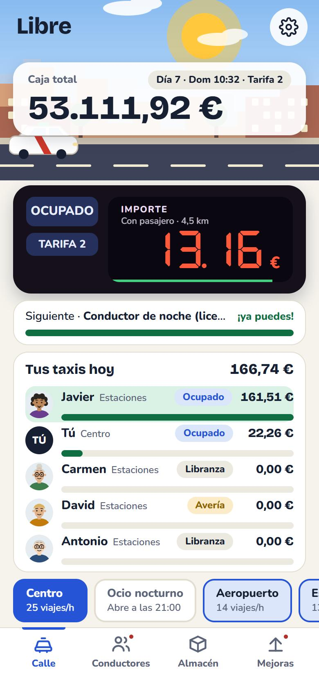
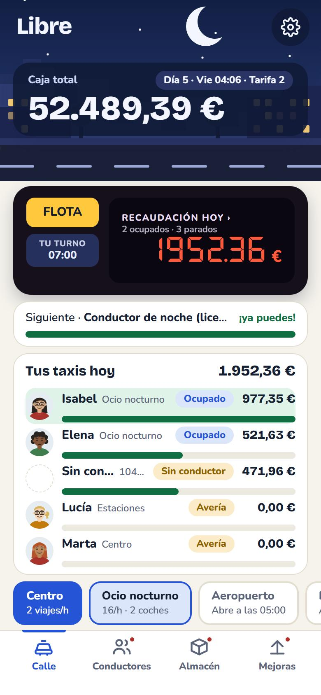
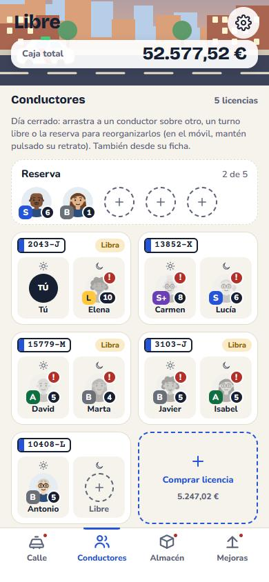
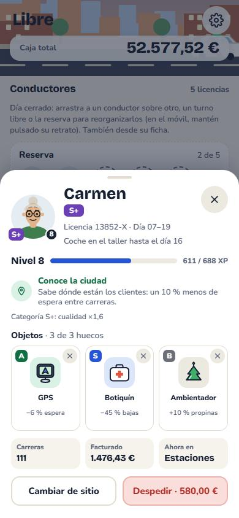
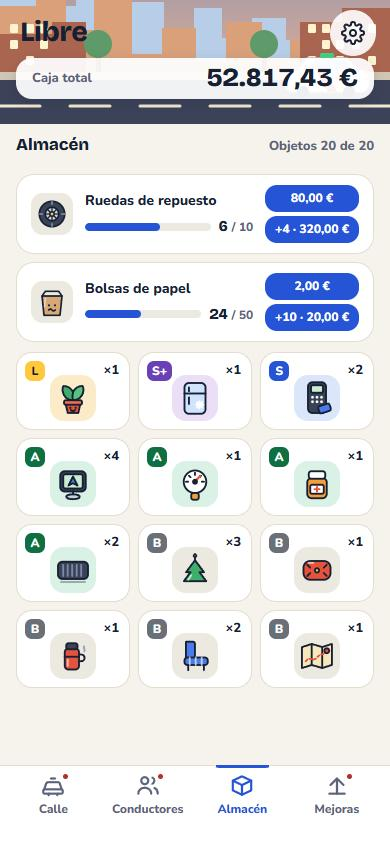
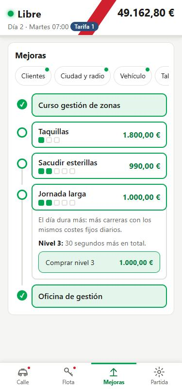
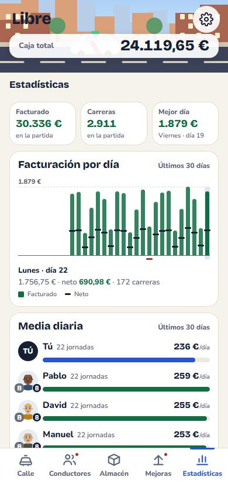
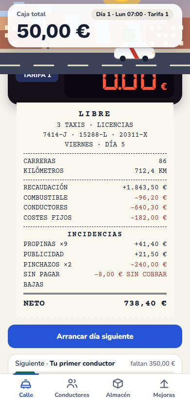

# Libre: documento de diseño

Iván · creado el 13 de noviembre de 2026 · actualizado el 17 de noviembre de 2026 (rework visual)

Este documento describe el juego tal como está hoy: qué es, cómo se juega, cada sistema con sus números y por qué está así. Las cifras exactas viven en `js/config.js`; si algo cambia allí, este documento debe seguirle.

---

## 1. Concepto

Juego incremental de gestión para navegador: empiezas como taxista autónomo en Madrid con un solo coche y creces hasta dirigir una flota. A largo plazo, la idea es llegar a un imperio de transporte mundial. Se llama **Libre**, por la luz verde del taxi.

- **Plataforma:** web, jugable en PC y móvil (pensado primero para móvil).
- **Género:** gestión idle, no clicker puro. El interés está en equilibrar piezas que dependen entre sí: licencias, coches, conductores, demanda y costes.
- **Tono:** realista y de barrio. Tarifas, licencias, libranzas, turnos y zonas basados en el taxi real de Madrid; los eventos y objetos tienen humor de taxista (la Planta de Paconi, el Bidón energético).
- **Objetivo del proyecto:** proyecto personal para divertirse y aprender a trabajar con Claude Code.

### Pilares

1. **El taxi de verdad.** Si un dato existe en el mundo real (tarifas, número de licencias, libranzas), el juego lo usa tal cual. Lo inventado se marca como valor de equilibrio.
2. **Decisiones, no clics.** Tus carreras son a clic, pero el juego se gana organizando: qué licencia comprar, a quién contratar, en qué turno ponerlo y qué llevar en el coche.
3. **Cada conductor es alguien.** Retrato, nombre, categoría, cualidades, defectos, nivel y objetos: la flota se recuerda por sus personas.
4. **Cuentas claras.** Cada jornada termina con un ticket de taxímetro que dice qué ha pasado y cuánto se ha ganado.

---

## 2. Bucle de juego

**Bucle corto (segundos).** Tocas el taxímetro, esperas cliente, el taxímetro sube en directo y cobras. Tus conductores hacen lo mismo solos y cada cobro salta en pantalla con su nombre («+14,20 € Marta»).

**Bucle medio (una jornada, unos 100 segundos).** El día avanza de 7:00 a 7:00 con tarifas y demanda que cambian por horas. Al cierre sale el ticket con recaudación, gastos, neto e incidencias; el juego se para hasta que arrancas el día siguiente. Entre jornadas reorganizas a tus conductores.

**Bucle largo (horas).** Compras licencias y coches, contratas conductores, abres zonas y mejoras, encuentras objetos y subes de nivel a tu gente. Cuando tienes la Oficina de gestión puedes dejar el volante y dirigir solo la flota.

**Ritmo medido** (18-11-2026, `tests/progresion.js`, 10 semillas; detalle en [docs/analisis-progresion.md](docs/analisis-progresion.md)): si priorizas la flota, la segunda licencia llega hacia el **minuto 33** y **tres licencias con sus seis turnos, hacia el 65**; a las dos horas y media, unas 8–9 licencias. Si vas comprando las mejoras baratas primero, la segunda licencia no llega hasta el minuto 109. Desde el 18-11 (licencia a 2.500 € y «Siguiente» que propone crecer), quien sigue la tarjeta tiene la segunda licencia hacia el **minuto 24**, tres hacia el 45 y unas 10–11 a las dos horas y media. Con todos los cambios del 18-11 por la tarde (sucesos más frecuentes, árbol de mejoras en cadena), la segunda llega hacia el **minuto 21**, la tercera hacia el 46, el Curso de zonas y RRHH hacia el 66–72, y a los 150 minutos hay unas 9–10 licencias con unos 2.200 € de neto por jornada. Antes del reequilibrio del 17-11, con las libranzas, eran 69–78 minutos para tres licencias.

---

## 3. Datos reales de Madrid

El juego calcula cada carrera con la fórmula real del taxímetro: inicio de servicio + kilómetros × precio por km + tiempo parado × precio por hora. Tarifas de 2026, en vigor desde el 1 de enero ([Europa Press](https://www.ultimahora.es/noticias/comunidades/2025/12/07/2526987/tarifas-taxi-ciudad-madrid-suben-partir-del-enero-2026.html), [Time Out Madrid](https://www.timeout.es/madrid/es/noticias/estos-seran-los-nuevos-precios-para-viajar-en-taxi-por-madrid-a-partir-de-2026-una-subida-de-mas-del-2-120925)).

| Tarifa | Cuándo se aplica | Inicio | Precio por km | Precio por hora |
| --- | --- | --- | --- | --- |
| Tarifa 1 | Laborables de lunes a viernes, 7:00 a 21:00 | 2,55 € | 1,40 € | 27,00 € |
| Tarifa 2 | Todos los días de 21:00 a 7:00; sábados, domingos y festivos de 7:00 a 21:00 | 3,20 € | 1,60 € | 29,00 € |
| Tarifa 3 | Salidas de Barajas a destinos fuera de la M-30 | 22 € de bajada de bandera que cubren los primeros 9 km; después, tarifa 1 o 2 | | |
| Tarifa 4 | Fija entre Barajas y el interior de la M-30 | 33 € | | |

Otros datos reales que usa el juego (confirmados por Iván el 13 y el 16 de noviembre de 2026):

- **Licencias en el área de Madrid:** 15.812 (el máximo que puede tener el jugador).
- **Espera en la parada de Barajas:** entre 1 y 2 horas.
- **Combustible:** 1,55 €/litro; el coche gasta 6 litros a los 100 km.
- **Cuota de autónomo:** 535 € al mes (17,83 € por jornada).
- **Seguro:** 10 € por coche y día. **Emisora:** 3 € por coche y día.
- **Conductor asalariado:** se queda el 50 % de lo que recauda.
- **Libranza:** cada licencia libra según su letra, que sale de la última cifra del número: lunes (L) si acaba en 7 u 8, martes (M) en 9 o 0, miércoles (X) en 1 o 2, jueves (J) en 3 o 4 y viernes (V) en 5 o 6. En fin de semana libra según la paridad del día del mes: una licencia par trabaja los días pares y libra los impares; una impar, al revés. La letra del miércoles está por confirmar (el juego usa X).

**Valores de juego, no reales:** licencia 2.500 € (sube un 15 % con cada compra; 3.000 € hasta el 18-11-2026) y coche 1.500 € (sube un 10 % con cada coche propio desde el 21-11-2026), fijados por Iván. Todo lo demás que no aparece arriba (demanda, precios de mejoras, probabilidades) es equilibrio y se ajusta jugando.

Datos reales que el juego aún no usa: tarifa 7 (recorridos de menos de 1.450 m, 8 €) y suplemento de Nochebuena y Nochevieja (7 €).

---

## 4. Pantallas

El juego es una sola columna, pensada para un móvil en vertical (390 × 844 de referencia). Arriba va siempre la **cabecera con la calle**; abajo, un menú fijo de cinco pestañas: **Calle**, **Conductores**, **Almacén**, **Mejoras** y **Estadísticas**. Los ajustes y la partida no son una pestaña: los abre el **engranaje** de la cabecera. Una marca roja en una pestaña avisa de que hay algo que comprar (Conductores, Mejoras), objetos esperando en la bandeja (Almacén), o un ticket por leer (Calle).

### Cabecera

Una escena dibujada de la calle: cielo que sigue la hora del juego (amanecer, día, atardecer y noche), sol o luna y estrellas, edificios con ventanas que se encienden y parpadean de noche y, en el tramo que se ve en el móvil, monumentos de Madrid en siluetas (Iván, 20-11-2026): las Cuatro Torres, Torrespaña, las Torres KIO, el Metrópolis con su Victoria dorada, Telefónica y la Puerta de Alcalá; árboles con copa de tres tonos, farolas en la acera de detrás (una cada ~100 px, 4 a la vista en el móvil; solo en ese lado porque la calzada llega al borde de abajo y delante taparían los vehículos) que de noche se encienden con poca luz: la lámpara, un halo suave y un poco de luz en el suelo (Iván, 22-11-2026), seis personas paseando por la acera en los dos sentidos (una con su perro, con orejas, hocico, collar, pelaje, cola que se mueve y cuatro patas que pisan el suelo; Iván, 21-11-2026), dos repartidores en bici roja (radios, cadena, sillín, guardabarros), uno con la mochila verde de Uber Eats y otro en sentido contrario con la naranja de Just Eat (Iván: «es un juego personal»), un autobús articulado de la EMT como los de verdad (foto de referencia de Iván: azul claro, techo blanco con los equipos de aire, banda negra de ventanillas, faldón gris, fuelle, tres puertas con pasamanos amarillos, letreros LED de la línea 34 «Las Águilas», llantas azules; ventanillas que se encienden de noche) en sentido contrario al taxi. Se circula por la derecha: hacia la derecha (taxi y Uber Eats) por el carril de delante y hacia la izquierda (autobús y Just Eat) por el de detrás, junto a la acera, nubes, un taxi que pasa (150 × 58 px; desde el 21-11-2026 las ruedas del taxi, las bicis y el autobús giran al avanzar; para que se note, el taxi lleva llantas de cinco radios, las bicis un reflectante naranja en los radios y el autobús cinco tuercas; una berlina blanca con las formas de un Toyota Corolla, sin marcas, con la franja roja de Madrid y la luz verde en el techo; Iván, 20-11-2026; de noche, el faro echa un haz de luz que se abre hacia el suelo y se apaga poco a poco, 22-11-2026) y lluvia cuando llueve. Es adorno: no enseña datos.

Encima va la placa **«Caja total»**, siempre a la vista y algo transparente para que se vea la calle detrás (Iván, 20-11-2026): el dinero y, en Calle, el chip «Día 7 · Dom 10:32 · Tarifa 2». En Calle la cabecera es alta (220 px; 180 en pantallas de menos de 830 px de alto, para que todo quepa sin desplazar); en las demás pestañas es compacta (124 px) y solo se ve la calle. Al desplazar la página sube hasta dejar solo la placa. De noche, la placa y el engranaje pasan a fondo oscuro con letra clara.

### Calle

<p>


</p>

De arriba abajo, debajo de la cabecera:

- **Taxímetro** de 132 px: cuerpo oscuro, piloto y tarifa a la izquierda y una pantalla de LED rojo (letra DSEG7, con punto decimal: «13.16 €»). Encima de las cifras, qué marca y una segunda línea con lo que pasa. Tres modos que cambian solos:
  - **Conductor** (izquierda), cuando conduces y es tu turno: piloto LIBRE en verde u OCUPADO, importe en vivo, «Con pasajero · 4,5 km» y una raya con el avance de la carrera. Todo el taxímetro es el botón de buscar cliente.
  - **Flota** (derecha), el resto del tiempo: piloto FLOTA en amarillo, el display suma lo recaudado hoy por toda la flota, la segunda línea resume «2 ocupados · 3 parados» y debajo del piloto sale la hora de tu turno. Tocarlo abre el desglose de la caja de hoy.
  - **Libranza**, el día que libra tu licencia si ningún taxi de la flota puede trabajar y no tienes otra licencia a la que pasarte: «HOY LIBRAS · Toca para saltar al cierre ›». Tocarlo salta al ticket de ese día (ver 5.4).
- **Siguiente:** tarjeta con lo que hace crecer la flota (Iván, 18-11-2026): si falta un coche o hay un turno libre, eso; si no, la próxima licencia o una mejora que cueste como mucho el 10 % de crecer (licencia y coche); con 3 licencias o más, también el Curso gestión de zonas y el Departamento de RRHH, para que lleguen conductores mejores. De esas, la más barata que aún no te puedes permitir, lo que falta y su barra; cuando llega el dinero dice «¡ya puedes!» y lleva a ella.
- **Tus taxis hoy:** una fila de 44 px por taxi con retrato (el de cada conductor lleva su rareza abajo a la izquierda y su nivel abajo a la derecha, como en Conductores), nombre, licencia y zona («15288-L · Centro»; si no cabe, se corta la zona, nunca la licencia), chip de estado (Libre en verde, Ocupado en azul, Libranza en gris, De baja en rojo; Avería, Pinchazo o Limpieza en ámbar), lo facturado en la jornada y una barra proporcional al que más lleva. Las filas se reordenan con una animación cuando un taxi adelanta a otro y destellan al cobrar. Con más de 6 taxis, «Ver los N restantes». Tocar una fila lleva a ese taxi en Conductores; tocar el total abre el desglose de la caja.
- **Zonas:** justo debajo del taxímetro (Iván, 22-11-2026: antes iban al final y con muchos taxis no se veían a la vez que el taxímetro); chips con el nombre y «25 viajes/h» (o «Abre a las 21:00»); en azul las que tienen clientes ahora y rellena la tuya cuando conduces (tocar otra te lleva allí). Las cerradas, en un último chip gris y discontinuo («2 cerradas · Qué las abre ›»); al tocarlo dice qué mejora abre cada una.

Con 5 taxis, Calle cabe sin desplazar en 390 × 844 y en 375 × 800. El **ticket de cierre** sale aquí, debajo del taxímetro, al acabar la jornada (ver más abajo).

### Conductores

<p>



</p>

- **Reserva:** tarjeta con 5 huecos. Los conductores que esperan turno son caras; los huecos libres («+») abren los candidatos.
- **Licencias, de dos en dos:** la placa con su número (siempre 5 cifras, con ceros delante: «00607-L») y letra (chip «Libra» el día que le toca librar) y dos casillas de turno, cada una con un sol o una luna, la cara y el nombre. La cara lleva la rareza abajo a la izquierda, el nivel abajo a la derecha y un «!» rojo si el conductor está parado (baja, avería, libranza). La última casilla es **«Comprar licencia»**, que abre dos placas para elegir, cada una con su libranza.
- **Sociedad limitada** (idea 1, Iván, 20-11-2026): con 3 licencias, para comprar la 4.ª hay que **montar una SL** (en la realidad, con unos 250.000 € de facturación al año ya toca dejar de ser autónomo). La casilla pasa a ser **«Montar una SL · 3.000 € · para la 4.ª licencia»** y abre una hoja **arriba de la pantalla** (para que el teclado del móvil no la tape; Iván, 20-11-2026) con lo que cuesta (3.000 € ahora, como «Constitución de la SL» en el ticket, y **10 € por conductor con turno** en los costes fijos de cada jornada) y un campo para el **nombre de tu flota** (2–24 letras). No da ninguna ventaja más: es un trámite para crecer (la mejora «Gestoría propia», al final de Taller y seguros, la rebaja). El nombre sale en una **placa junto al logo** de la cabecera y se puede cambiar en Ajustes. «Siguiente» la propone cuando toca. Medido con el bot: la 4.ª licencia llega unos 8–10 minutos más tarde y las siguientes, unos 9–12.
- **Ficha del conductor** (centro): una hoja que sube desde abajo (se desplaza por dentro desde que lleva las estadísticas). Nombre, rareza, licencia y turno; nivel con su barra de experiencia; cualidades en verde y defectos en rojo, cada uno con lo que hace; un mosaico de 3 casillas de objetos (puesto, con su efecto en corto y una «×» para quitarlo; «Equipar»; o el nivel que abre el hueco); carreras, facturado y zona (solo de lectura: la eligen ellos); los botones **Comparar con otro conductor**, **Cambiar de sitio** y **Despedir · finiquito**, y al final las **estadísticas** (ver abajo). Los botones van antes de las estadísticas para no tener que bajarlas enteras (Iván, 20-11-2026). Cambiar de sitio solo se puede entre jornadas: durante el día sale desactivado con una línea que lo explica.
- **Estadísticas de la ficha** (Iván, 17-11-2026): el valor real de cada stat del conductor, ya sumados rasgos, objetos, nivel y mejoras y con los topes, y debajo de dónde sale cada cambio. En verde si le favorece y en rojo si le perjudica:
  - **Espera entre carreras**: en % (no hay un tiempo fijo, depende de la zona y la hora), con los rasgos y objetos de día o de noche marcados; los que no son de su turno salen con «no cuenta».
  - **Propina**, **Se va sin pagar**, **Devuelve un olvido** y **Encuentra un objeto**: % de las carreras.
  - **Baja**, **Pinchazo** y **Avería**: % de los turnos (se sortean al empezar cada uno). La avería suma los km de su coche («Kilómetros del coche +60 %»).
  - **Limpiar un vómito**: lo que cuesta y cuánto tiempo para.
  - Las cualidades y defectos salen con la fuerza de su categoría (una cualidad de un S pesa más que la de un B), y si una stat llega al tope lo dice.
- **Comparar** (Iván, 18-11-2026): «Comparar con otro conductor» en la ficha te deja tocar a otro (también durante la jornada) y abre una hoja con los dos lado a lado: cara, rareza, nivel y dónde trabajan; un resumen («Isabel es mejor en 2 de 9 estadísticas; Elena, en 1»); una fila por estadística con el mejor de los dos en verde y «▲»; y rasgos, objetos, carreras y facturado. Cada uno cuenta en su turno (lo que es solo de día o de noche, en el suyo). Con el día cerrado, «Intercambiarlos» los cambia de sitio. Cada candidato tiene además «Comparar con…» para elegir a uno de tus conductores.
- **Equipar** abre encima otra hoja con los objetos del almacén en casillas, de mejor a peor; los que ya lleva salen atenuados. Tocar uno lo equipa.
- **Candidatos** (derecha): hoja con tres tarjetas, cada una con retrato, rareza, rasgos, «Contratar · precio» y «A la reserva»; si no llega el dinero, cuánto falta y, al pie, vender objetos para contratar. Si tu turno de esa licencia está libre, también «Conducir yo este turno».
- **Entre jornadas** (con el día cerrado), los conductores se cambian de sitio: con ratón, arrastrándolos; en el móvil, **manteniendo pulsado** su retrato medio segundo (lo «coge», vibra un poco) y **tocando dónde ponerlo** (otro conductor para intercambiarlos, un turno libre o un hueco de la reserva). Si sigues con el dedo, también se arrastra. «Cambiar de sitio» en la ficha hace lo mismo. Mientras está cogido, una barra dice «Toca dónde poner a Elena · Cancelar» (Iván, 18-11-2026: en el móvil el arrastre no funcionaba).

### Almacén

<p>

</p>

- **Título:** «Almacén», al lado lo que **vale** todo lo guardado (lo que te darían vendiendo el almacén y la bandeja, en verde; Iván, 20-11-2026) y, a la derecha, «Objetos N de M».
- **Objetos sin equipar:** casillas de 3 columnas, de mejor a peor, **sin nombre a la vista** (decisión de Iván): rareza, cantidad y el dibujo sobre el color de su categoría. Al tocar una se abre debajo su panel con el nombre, qué hace, cuántos hay equipados, «Combinar» y «Vender».
- **Bandeja:** si un conductor encuentra algo con el almacén lleno, arriba aparece en amarillo «Almacén lleno · N por guardar», con lo que espera y la lista para vender.

### Mejoras

<p>

</p>

Todo el árbol en una pantalla (Iván, 18-11-2026): arriba el logo, del que salen las cinco ramas en columnas (Clientes, Ciudad, Coche, Taller y Equipo). Cada mejora es un círculo con su icono, unido al de antes por una línea (verde si lo de antes está comprado), con las rayitas de sus niveles y el precio de lo siguiente debajo. Estados: **comprada** (verde con ✓), **disponible** (azul relleno), **sin dinero** (azul claro, precio en gris) y **bloqueada** (gris con candado). Al tocar una sube su ficha desde abajo: icono, nombre, rama, nivel, qué hace y «Comprar nivel 3 · 1.000,00 €»; se cierra con ×, el fondo o Escape.

**Lo que te ha hecho ganar cada mejora** (idea 16, Iván, 22-11-2026): en la hoja de una mejora comprada, una cifra en verde, «Te ha hecho ganar» o «Te ha ahorrado», desde que la compraste. Solo en las que se puede contar directamente:

- **Ganado:** Publicidad en el taxi (lo que cobra al cerrar la caja) y Sacudir esterillas (las monedas).
- **Ahorrado:** combustible (Curso de conducción eficiente, Neumáticos de bajo consumo, Flota híbrida y Depósito de GLP), seguro (Curso de seguridad vial y Póliza de flota), averías (Mecánico propio), pinchazos (Grúa propia) y coches (Leasing). Cada una cuenta lo que habrías pagado de más sin ella, con las demás que tengas: pagado × (1/factor − 1).

Las que cambian cuántas carreras se hacen (demanda, búsqueda, zonas, propinas, Jornada larga…) y las que no dan euros (Taquillas, Curso de zonas, RRHH, Oficina, Emisora) no enseñan nada: no se puede saber qué habría pasado sin ellas. En las partidas de antes se empieza a contar desde esta actualización, y la hoja lo dice.

### Estadísticas

<p>

</p>

Pestaña nueva del 18-11-2026 (Iván). De arriba abajo:

- **Cuatro cifras de la partida:** lo facturado, las carreras, el mejor día (con su fecha) y los km recorridos por tu flota (sin contar los que traía el coche de segunda mano; no se pierden aunque cambie un coche).
- **Facturación por día:** una barra verde por cada uno de los últimos 30 días, con una raya para el neto (roja si ese día se perdió dinero; entonces baja del cero). Tocar una barra enseña debajo su día, lo facturado, el neto y las carreras; al entrar está elegido el último.
- **Media diaria:** tú (barra azul, arriba) y cada conductor que tiene turno ahora (barras verdes, de mayor a menor), con lo que facturó de media por jornada en los últimos 30 días, contando solo las jornadas que estuvo en la flota (los días de libranza de su licencia no cuentan, para no bajarle la media; los de baja o avería, sí; la reserva no entra). Al lado, cuántas jornadas lleva la cuenta.
- **Mejores conductores:** los diez que más han facturado en la partida, con medalla de oro, plata y bronce para los tres primeros. Entran también los despedidos (atenuados, con el chip «Despedido»). Tocar a uno que sigue contigo abre su ficha en Conductores.

Los días se guardan desde esta versión: en una partida de antes, el historial empieza con el último cierre. Sin ningún día cerrado, cada bloque dice qué hace falta para llenarlo.

### Ticket de cierre y ajustes

<p>


</p>

- **Ticket de cierre** (izquierda): aparece en Calle al acabar la jornada, en papel térmico con letra de máquina (Courier Prime). Cabecera con las licencias que trabajaron y, en bloques separados por rayas: carreras y kilómetros; recaudación, combustible, conductores y costes fijos; las incidencias, y abajo del todo, tras una doble raya, el **neto**, que ya las cuenta. Lo que resta sale en rojo (el neto, solo si es negativo). El juego se para hasta «Arrancar día siguiente».
- **Ajustes y partida** (derecha), desde el engranaje: parar al cierre del día, sonido sí o no y volumen, y exportar, importar o borrar la partida (importar y borrar se confirman en la misma hoja; al importar se ignoran los espacios, saltos y caracteres invisibles que se cuelan al copiar en el móvil). Al final, el panel plegado **Actualizaciones** (Iván, 19-11-2026): todas las actualizaciones del juego numeradas, por días y de la más nueva a la más vieja (el mismo texto que docs/historial.md).
- **Avisos** (Iván, 19-11-2026): un recuadro oscuro encima del menú, de lado a lado de la pantalla (letra de 14 px), que dura 3,5 s; como mucho tres en cola, uno cada 3 s. Los de eventos de la partida, de los conductores (con su retrato: nivel, objeto encontrado, baja, pinchazo, avería…) y generales (lluvia, tormenta, la avería de tu coche…), solo salen en **Calle** (Iván, 20-11-2026; antes, los de conductores también en Conductores); en las demás pestañas se descartan (suena el sonido igual, y lo que cuesta va al ticket). Los que responden a lo que tocas (compras, «Partida importada», «Mientras estabas fuera…») salen en todas.

### Sistema visual

Estilo ilustrado y cálido, tema claro. La referencia completa (maquetas, iconos y fuentes) está en `libre-rework/`, fuera del repositorio.

- **Colores** («Cielo de Madrid»): fondo de papel `#F6F3EC`, tarjetas blancas con borde `#E3DDCF`, tinta azul oscura `#172033`. **Azul** `#2554D6` para la marca, los botones y lo ocupado; **verde** `#0F6E42` para el dinero y lo libre; **amarillo sol** `#FFC83D` para destacar; **rojo** `#B3302A` para gastos, bajas y peligro. Los estados van sobre tintes claros (verde, azul, ámbar, rojo y neutro). Todos los colores son variables en un solo sitio (`:root` de `css/estilos.css`).
- **Rarezas:** B gris, A verde, S azul, S+ morado y LEGENDARIO amarillo, siempre en una insignia redondeada con la letra.
- **Letras:** Bricolage Grotesque para títulos y cifras de dinero; Nunito para el texto; Courier Prime para el ticket; DSEG7 para el LED del taxímetro.
- **Componentes:** tarjetas de esquinas redondeadas, chips de estado, botones de 48 px (principal azul, secundario blanco, peligro rojo claro), barras de 8 px e insignias de rareza. Todo lo que se toca mide al menos 44 px.
- **Logo:** un taxi de Madrid de frente, con la luz verde de «libre» y el sol, sobre el azul de marca (`docs/logo/libre-icono.svg`, también icono de la pestaña); con el nombre en Bricolage Grotesque en `docs/logo/libre-logo.svg`.
- **Iconos:** cada objeto tiene su dibujo (37 en total, con trazo oscuro y relleno plano). Los rasgos y los turnos usan iconos de trazo.
- **Animaciones:** el taxi que cruza la calle (16 s), dos nubes (40 y 55 s), el sol que late (5 s), las ventanas de noche (4 y 6 s), la lluvia, el ticket que se imprime, las filas que se reordenan, los importes que flotan al cobrar y las hojas que suben. Todas se apagan con «reducir movimiento».
- **Sonidos**, sintetizados en el navegador (sin archivos) y mudos hasta el primer toque: **cobro** (un «ding» de caja registradora al cobrar cualquier taxi), **propina** (monedas), **nivel** (arpegio), **objeto** (brillo), **avería** (golpe sordo; también pinchazos), **ticket** (impresora) y **tic** (al bajar la bandera). Se ajustan a oído.

---

## 5. Sistemas

### 5.1 Reloj y jornada

- **Un día de juego dura 100 segundos reales.** La mejora Jornada larga lo alarga hasta 60 s más; los coches trabajan al mismo ritmo real, así que caben más carreras contra el mismo coste fijo diario.
- **Turnos:** día de 7:00 a 19:00 y noche de 19:00 a 7:00.
- **Jornada de 7:00 a 7:00.** A las 7:00 se cierra la caja, se cobran los costes fijos y sale el ticket. La madrugada cuenta como la noche del día anterior.
- **Fin de semana:** sábado y domingo, tarifa 2 todo el día.
- **Sin conexión:** el juego cuenta hasta 8 horas reales fuera, con la media de cada zona y hora (sin eventos nuevos). Si había pausa al cierre, resuelve los días seguidos y deja un único ticket con la suma. Da entre un 2 % y un 4 % más que jugando (medido el 17-11-2026 con varias flotas; con conductores de mucha o poca espera, algo más). Tu turno no produce mientras estás fuera.

### 5.2 Zonas

Cada zona tiene una demanda de viajes por hora que cambia con la hora, el día de la semana y un pequeño azar por jornada (±20 %). Si hay más coches de los que la zona pide, los que sobran esperan más y gastan combustible en vacío (o esperan en la cola sin gastar, en las zonas con parada).

| Zona | Cómo se abre | Carácter | Viajes |
| --- | --- | --- | --- |
| Centro | Desde el principio | Muchas carreras cortas, demanda constante; se vacía de madrugada | 1,8 km (45 %), 3,5 km (40 %), 7 km (15 %) |
| Ocio nocturno | Desde el principio | Solo de noche y sobre todo de jueves a sábado; siempre tarifa 2; rinde claramente más que el centro de noche | 4 km (30 %), 8 km (45 %), 13,5 km (25 %) |
| Estaciones | Mejora Parada en Atocha y Chamartín | Picos con la llegada de los trenes; cola corta de unos 6 min | 3 km (35 %), 6 km (45 %), 11 km (20 %) |
| Aeropuerto | Mejora Acreditación de Barajas | Carreras caras con tarifa fija; cola de 1 a 2 horas en la parada | 60 % tarifa 4 (33 €), 40 % tarifa 3 a 7, 18 o 32 km |

**Lluvia** (Iván, 18-11-2026): el 25 % de las jornadas llueve, y la demanda se duplica en todas las zonas mientras dura. El 65 % de las veces es un **chubasco** (de 30 minutos a 1 hora) y el 35 % una **tormenta** (de 3 a 5 horas; Iván); el aviso dice cuál. De media, unas 0,47 horas de lluvia por jornada (antes, con 1–3 horas en el 20 % de las jornadas, unas 0,4). La tormenta tiene su propia escena en la cabecera: cielo oscuro sin sol ni luna, relámpagos que lo iluminan con un rayo, más lluvia inclinada, viento y hojas volando (todo fuera con «reducir movimiento», salvo el cielo oscuro).

### 5.3 Carreras

- **Tus carreras (a clic):** tocas el taxímetro, esperas según la demanda de tu zona (con poca demanda, hasta que aparece alguien), viajas y cobras. Solo puedes trabajar dentro de la franja de tu turno y no el día que libra tu licencia.
- **Las de tus conductores (solas):** cada conductor espera su parte de la demanda de la zona, viaja y cobra al terminar; el 50 % es suyo. Sin clientes, hace un tramo en vacío hasta la hora siguiente.
- **Zonas de los conductores:** las eligen ellos. Sin el Curso gestión de zonas, al azar entre las que tienen clientes; con el curso, cada hora la que más deja al dueño contando a los compañeros. La tuya la eliges tú.

### 5.4 Licencias, coches y libranza

- **Licencia:** 2.500 € la segunda y un 15 % más cara cada siguiente, hasta las 15.812 de Madrid. Al comprarla eliges entre **dos placas con letras distintas**, cada una con su libranza.
- **Coche:** 1.500 € el segundo (un solo modelo, Turismo). Sin coche, la licencia no trabaja. Desde el 21-11-2026 (Iván: al final de la partida salían regalados) **cada coche propio cuesta un 10 % más que el anterior**, como las licencias pero algo menos: 1.500 € el 2.º, ~1.815 € el 4.º, ~2.196 € el 6.º, ~2.657 € el 8.º, ~3.215 € el 10.º y ~3.891 € el 12.º. Los de alquiler no cuentan. Renovar uno, o reponerlo tras una avería definitiva, cuesta lo que tu último coche, no el siguiente; lo que te dan por el viejo sale de ese mismo precio. Leasing resta su 30 % sobre el precio ya subido. Medido con el bot (10 partidas, 240 min): hasta la 5.ª licencia no cambia nada; la 10.ª llega unos 9 minutos más tarde y la 12.ª unos 17 (~8 %).
- **Kilometraje** (Iván, 19-11-2026): cada coche lleva sus km, que se ven bajo la placa de su licencia («92.391 km ›»). El coche con el que empiezas es de **segunda mano**, con entre 85.000 y 100.000 km; los que compras salen **nuevos, a 0 km**. Suman lo mismo que la línea «Kilómetros» del ticket: con cliente, buscándolo y en vacío (sin conexión, los de cada zona se reparten entre sus coches). En la realidad un taxi a doble turno hace 550–750 km al día, a 25–35 km/h de media en la jornada (dato de Iván). Para acercarse, el 19-11-2026 la velocidad en vacío pasó de 18 a **72 km/h**: no es real, compensa que las carreras del juego son lentas (12–16 km/h en Centro). Un coche con dos conductores hace ahora unos 730 km por jornada trabajada al principio de la partida (~30 km/h) y unos 500 en una flota con colas en Estaciones y Aeropuerto, donde el coche espera parado (medido; ver docs/analisis-km.md). Más km es más combustible, a propósito: el neto baja un 13 % al principio y un 6 % con flota avanzada, y el bot tarda un 8–12 % más en llegar a cada licencia. - **Desgaste y avería definitiva** (idea 7, Iván, 19-11-2026): con los km, el coche se gasta. Las averías normales suben (×2 a los 200.000 km) y desde los 130.000 km puede romperse del todo (ver 5.8). Medido con un script: el coche inicial aguanta de media unas **157 jornadas (~4,4 h de juego**; 8 de cada 10, entre 3 y 5,6 h) y uno nuevo, unas 300. Con la Jornada larga las horas reales no cambian, porque el coche hace más km en una jornada más larga. Sin conexión no se rompe (no hay eventos nuevos), pero suma km. También se rompe tu coche: entonces no puedes buscar cliente («Tu licencia no tiene coche») y, si nadie trabaja, el taxímetro deja saltar al cierre («SIN COCHE»; con el coche en el taller, «COCHE EN EL TALLER»).
- **Hoja del coche:** bajo la placa de cada licencia, una pastilla con un coche, los km y «›», del color de su estado (gris, ámbar si está Gastado, rojo si está Al límite; Iván, 19-11-2026: así se ve que se toca). Tocarla abre la hoja: kilómetros, estado (**Nuevo** hasta 20.000 km, **Rodado** sin riesgo, **Gastado** con riesgo y **Al límite** desde un 1 % por turno; los km salen en ámbar o en rojo bajo la placa), la probabilidad de avería definitiva y de avería por turno, lo que te dan por él y **«Renovar coche»**: compras uno nuevo a 0 km y vendes el viejo por la mitad del precio de un coche menos cuanto más km tenga (nada a los 230.000 km; como poco, los 50 € de chatarra: con 92.000 km, unos 450 €; con 200.000, unos 100 €). Solo con el día cerrado; si estaba en el taller, el nuevo sale sin avería. En la ficha del conductor, justo encima de las estadísticas, una línea con su coche y su riesgo abre la misma hoja, y la avería de sus estadísticas suma los km de su coche.
- **Alquilar coche** (idea 5, Iván, 20-11-2026): una licencia sin coche ofrece **«Coche · 1.500 €»** y **«Alquilar · 400 €»** (3 días, el de hoy incluido, pagados al momento: ~133 € por jornada). Desde el 21-11-2026 el alquiler **sube un 10 % por coche propio, igual que el coche** (sin el descuento del Leasing), para que con una flota grande nunca salga más a cuenta alquilar que comprar. Es un apaño para cuando no te llega para comprar (tras una avería definitiva o con una licencia nueva): a partir de unas 11 jornadas, alquilar sale más caro que comprar, a propósito, para que no se convierta en la costumbre. El coche alquilado trabaja igual, paga su seguro y **no se gasta** (sin avería definitiva ni más averías por km; no se renueva). Su pastilla, azul, dice «Alquiler · 3 días» y abre una hoja con lo que queda, **«Alquilar 3 jornadas más · 400 €»** y **«Comprar uno propio»** (devuelves el alquilado y pierdes lo que quedaba). Al cerrar la caja de su última jornada se devuelve solo, también sin conexión, con un aviso y la línea «Fin de alquiler» en el ticket. Si la licencia se queda sin coche pero tiene conductores, sus turnos se siguen viendo: esperan al coche.
- **Libranza:** el día que le toca, la licencia no trabaja en ninguno de sus dos turnos, tampoco el tuyo. Cada licencia libra unos 2 de cada 7 días (su día de semana y la mitad de los fines de semana). Los costes fijos se pagan igual: elegir bien la placa reparte las libranzas de la flota.
- **Saltar el día de libranza:** si libra tu licencia y ese día no puede trabajar nadie (no hay conductores, o sus licencias también libran o están de baja o averiadas) y no tienes otra licencia a la que pasarte, el taxímetro ofrece **saltar al cierre**: el reloj corre de golpe hasta las 7:00, se pagan los costes fijos y sale el ticket del día. Cuenta como licencia a la que pasarte una con coche, que no libre ese día y con un turno libre, si tienes la Oficina de gestión (sin ella no puedes dejar tu turno). Si hay flota trabajando, el día corre normal.

### 5.5 Costes

| Coste | Cuánto | Cuándo |
| --- | --- | --- |
| Combustible | 1,55 €/l × 6 l/100 km, también en vacío | En cada carrera |
| Conductor | 50 % de lo que recauda | En cada carrera |
| Cuota de autónomo | 17,83 € | Al cierre de cada jornada |
| Seguro | 10 € por coche (baja con mejoras) | Al cierre |
| Emisora | 3 € por coche, solo con la mejora Emisora | Al cierre |
| Sociedad limitada | 10 € por conductor con turno, desde que la montas | Al cierre |
| Incidencias | Limpiezas, neumáticos, reparaciones, finiquitos | Cuando pasan |

### 5.6 Conductores

**Personajes.** 32 (Iván, 20-11-2026: antes 16), cada uno con su nombre y su retrato, montado por piezas: cara, piel, peinado y color, gafas (redondas, cuadradas o de sol), barba, ropa, edad y accesorios (gorra, pajarita, traje con corbata y pendientes). Los nuevos: Paco, Mari Carmen, José Luis, Juan, Rafa, Cristina, Ángel, Raquel, Miguel, Fernando, Sonia, Rubén, Lola, Daniela, Álvaro y Daniel.

**Contratar.** Hay siempre tres candidatos (personajes y cualidades distintos), con su retrato, categoría, rasgos y precio. Cambian cada día, al cerrar la caja (Iván, 17-11-2026), y también al contratar a uno: entonces salen otros tres. Si no te llega, la tarjeta dice cuánto falta y deja vender objetos ahí mismo. Se puede contratar para un turno libre o para la reserva.

**Categorías.** Salen al azar, con los mismos pesos que los objetos (la mejora Departamento de RRHH los cambia para los candidatos):

| Categoría | Probabilidad | Precio | Cualidades | Defectos | Fuerza de la cualidad | Fuerza del defecto | Encuentra objetos | Espera de serie | Abre los topes |
| --- | --- | --- | --- | --- | --- | --- | --- | --- | --- |
| B | 65 % | 400 € | 1 | 2 | ×1 | ×1 | ×1 | — | 0 |
| A | 25 % | 850 € | 1 | 1 | ×1,2 | ×0,85 | ×1,15 | −5 % | 0,1 |
| S | 7,5 % | 1.200 € | 1 | 1 la mitad de las veces | ×1,4 | ×0,7 | ×1,3 | −12 % | 0,2 |
| S+ | 2 % | 1.800 € | 1 | 0 | ×1,6 | — | ×1,5 | −25 % | 0,3 |
| LEGENDARIO | 0,5 % | 3.350 € | 2 | 0 | ×1,8 | — | ×2 | −55 % | 0,75 |

**Que la categoría se note más que el nivel** (Iván, 17-11-2026): cada categoría espera menos de serie, le toquen los rasgos que le toquen, y abre más sus topes. Medido con un bot al final de la partida (nivel 10 y los mismos tres objetos buenos para todos), un conductor deja por jornada: B 151 €, A 164 €, S 174 €, S+ 185 € y LEGENDARIO 223 € (**+47 % sobre un B**).

**Precios** (Iván, 17-11-2026): el del B más lo que un conductor de esa categoría deja de más que un B en **40 jornadas** (unos 67 minutos de juego), medido con un bot al principio de la partida: A +11 €, S +20 €, S+ +35 € y LEGENDARIO +74 € por jornada. Antes un LEGENDARIO costaba 12.000 € y tardaba unas 450 jornadas en compensar frente a un B.

Con tres candidatos, una de cada 65 tandas más o menos ofrece un LEGENDARIO (y ahora sale una tanda nueva cada día, además de una tras cada contrato); al principio cuesta ahorrar para él, y esa es la gracia.

**Rasgos.** Una cualidad nunca sale con su defecto opuesto. La fuerza de la categoría escala el efecto («+45 %» con fuerza ×1,8 es «+81 %»).

Equilibrio (Iván, 17-11-2026): cada cualidad vale cerca de **+5 %** de lo que deja un conductor B y cada defecto cerca de **−5 %**, medido con un bot (480 partidas de 120 jornadas por rasgo, sin mejoras ni bolsas; los de solo día o solo noche, sobre los conductores de ese turno). La curva sale de ahí: al nivel 10 se pierde un defecto, y con mejoras algunos efectos se anulan (bolsas: la limpieza; la mejora contra impagos: los sin pagar). Por eso los rasgos que dependen de esos sucesos llevan un segundo efecto.

| Cualidad | Efecto | Defecto opuesto | Efecto |
| --- | --- | --- | --- |
| Simpático | el doble de propinas | Antipático | −75 % de propinas y +8 % de espera |
| Cuidadoso | −75 % de pinchazos y averías, −38 % de limpieza | Manazas | +75 % de pinchazos y averías, +50 % de limpieza |
| Conoce la ciudad | −12 % de espera | Lento | +14 % de espera |
| De hierro | −80 % de bajas y −9 % de espera | Enfermizo | el doble de bajas y +8,5 % de espera |
| Ojo avizor | −80 % de clientes sin pagar y −10 % de espera | Despistado | el doble de clientes sin pagar y +11 % de espera |
| Honrado | el doble de objetos devueltos y +35 % de propinas | Aprovechado | −70 % de objetos devueltos y −60 % de propinas |
| Búho | −12 % de espera de noche | Trasnochador flojo | +18 % de espera de noche |
| Madrugador | −12 % de espera de día | Dormilón | +16 % de espera de día |
| Pulcro | la mitad de limpieza y +45 % de propinas | Guarro | +70 % de limpieza y −45 % de propinas |
| Urraca (18-11-2026) | +20 % de objetos encontrados y un 15 % de que suban de categoría | Desastre | −40 % de objetos encontrados |
| Anfibio (18-11-2026) | cobra ×3,1 en las carreras que empiezan lloviendo | Azucarillo | no trabaja mientras llueve: se queda en el coche hasta que escampa |

**Anfibio** (Iván, 18-11-2026): solo cuenta con lluvia (unos 14 minutos por turno de media; sin conexión no llueve). Por eso el multiplicador es alto: medido con un bot (480 partidas por valor, con un 35 % de tormentas), ×2 vale +2,3 %, ×3 +4,7 % y ×3,5 +5,8 %; **×3,1 queda en +5 %**, lo mismo que las demás cualidades. Da días de lluvia muy buenos y el resto, nada. Su opuesto, **Azucarillo** («¡que no es de azúcar!»), solo tiene ese efecto, sin nada más (Iván): mientras llueve se queda parado, con el chip «Lluvia» en «Tus taxis hoy», y vuelve en cuanto escampa. Resta un **−2,2 %** a un conductor B (medido con un 35 % de tormentas, 480 partidas): menos que los demás defectos, porque solo cuenta con lluvia.

«Limpieza» es el coste y el tiempo parado al limpiar un vómito (no cuenta si el conductor lleva la Bolsa para vómitos).

**Experiencia y niveles.** Cada carrera da 1 punto (un conductor hace unas 25–30 por jornada). Cada nivel acorta la espera un 1,5 % (antes un 2,5 %: pesaba más que la categoría); los niveles 4 y 8 abren un hueco más de objeto. **Al llegar al nivel 10** pierde un defecto o, si no tiene ninguno, gana una cualidad nueva.

| Nivel | 1 | 2 | 3 | 4 | 5 | 6 | 7 | 8 | 9 | 10 |
| --- | --- | --- | --- | --- | --- | --- | --- | --- | --- | --- |
| Experiencia total | 0 | 20 | 48 | 87 | 142 | 219 | 326 | 477 | 688 | 983 |
| Huecos de objeto | 1 | 1 | 1 | 2 | 2 | 2 | 2 | 3 | 3 | 3 |

El nivel 5 llega hacia la quinta jornada y el 10 hacia la 35 (cerca de una hora de juego por conductor).

**Topes que crecen** (Iván, 17-11-2026). Rasgos, nivel, objetos y mejoras se multiplican, pero el resultado no pasa de unos límites sobre el valor normal. Lo malo tiene siempre el mismo freno; lo bueno se abre con la categoría y el nivel: cada conductor tiene una apertura de 0 a 1 (la de su categoría, en la tabla de arriba, más 0,25 por subir del nivel 1 al 10). Con apertura 0 (un B de nivel 1) valen los topes de la primera columna; con 1 (un LEGENDARIO de nivel 10), el extremo; entre medias, a medio camino.

| Valor | Lo malo, como mucho | Lo bueno con apertura 0 | Lo bueno con apertura 1 |
| --- | --- | --- | --- |
| Espera entre carreras (sin contar las mejoras de búsqueda) | ×1,4 | ×0,6 | ×0,2 |
| Propinas (con la mejora Propinas) | ×0,5 | ×2,5 | ×7 |
| Objetos devueltos | ×0,3 | ×2 | ×4 |
| Sin pagar, bajas, pinchazos, averías | ×2 | ×0,3 | ×0,05 |
| Limpieza de un vómito | ×1,5 | ×0,4 | ×0,15 |
| Lo que cobra con lluvia (Anfibio) | ×1 | ×3,1 | ×6 |

Por ejemplo, la espera de un B de nivel 10 puede bajar hasta ×0,46 y la de un S+ de nivel 10 hasta ×0,33. La ficha enseña el tope de cada stat («su tope ×0,46»).

Tres objetos no son un factor y no tienen tope: la **Cámara de seguridad** deja a cero los clientes sin pagar, la **Bolsa para vómitos** evita los vómitos y la **Rueda de repuesto** hace que un pinchazo no cueste ni pare.

**Reserva.** Hasta 5 conductores contratados sin turno. No trabajan, no ganan experiencia y no cuestan nada; conservan objetos y nivel.

**Reorganizar.** Solo entre jornadas, con el día cerrado: un conductor se arrastra, o se coge y se toca el destino (también desde su ficha), a otro turno, otra licencia o la reserva; si el sitio está ocupado, se intercambian. Baja, objetos y nivel van con él; la avería se queda en el coche.

**Despedir.** Cuesta un finiquito de 100 € + 60 € por nivel (160 € en el nivel 1, 700 € en el 10), pide confirmación y sale en el ticket. Sus objetos vuelven al almacén.

**Tú.** Tu turno es siempre a clic y no tiene rasgos ni nivel. Con la Oficina de gestión puedes dejar el volante y volver a un turno libre cuando quieras.

### 5.7 Objetos y almacén

- **Encontrarlos:** cada carrera de un conductor tiene un 0,9 % de dar un objeto (más según su categoría; hasta el 19-11-2026, un 1,2 %: un jugador de final de partida se quejó de que salían demasiados). Medido: con 1 conductor B sale uno cada ~5 jornadas (~7 por hora de juego); con 7 conductores, ~35 por hora; con 20 de categorías altas y Jornada larga 5, ~160 por hora (antes ~218). Tú no encuentras, y sin conexión tampoco. Se sortea la categoría con los pesos de la tabla de arriba y, dentro de ella, el objeto. Sale un aviso con su retrato.
- **Almacén:** guarda 10 objetos sin equipar (hasta 40 con Taquillas). Si está lleno, lo encontrado espera en una **bandeja** hasta que vendes algo: nada se vende solo.
- **Equipar:** desde la ficha de cada conductor, en sus huecos, sin repetir objeto. Quitarlo lo devuelve al almacén.
- **Vender:** B 20 €, A 50 €, S 150 €, S+ 400 €, LEGENDARIO 1.200 € (Iván, 18-11-2026; antes, 40 / 120 / 400 / 1.200 / 4.000 €, y vender ganaba a equipar). Entra en la caja como «Venta de objetos».
- **Frase:** cada objeto tiene su chiste (Iván, 18-11-2026), que sale en su panel del Almacén.
- **Encontrar más y mejor:** algunos objetos y la cualidad Urraca suben la probabilidad de encontrar (con tope) o hacen que lo encontrado suba una categoría («suerte», como mucho un 40 %, más con la categoría y el nivel).
- **Combinar** (Iván, 18-11-2026; retocado el 19-11): objetos sin equipar de la misma categoría se cambian por uno al azar de la categoría siguiente: **3 B → 1 A, 4 A → 1 S, 4 S → 1 S+ y 5 S+ → 1 LEGENDARIO** (antes, 3 en todas; un LEGENDARIO sale de 240 B en vez de 81). Los LEGENDARIOS no se combinan. **Eliges cuáles gastas:** el panel lista los de esa categoría con «−» y «+» (empieza con el tocado, sus copias y los más repetidos) y «Combinar» se activa con justo los que pide. Deja hueco en el almacén, así que entra lo que esperaba en la bandeja. Con 20 conductores, combinándolo todo salen ~3 LEGENDARIOS por hora (antes ~8; cálculo a mano).

| Categoría | Objeto | Efecto | Frase |
| --- | --- | --- | --- |
| B | Mapa del Metro de 1998 | Ninguno (sirve para combinar) | No sale ni la línea 8. Lo guardas por si vuelve 1998. |
| B | Perrito del salpicadero | +8 % de propinas, −3 % de espera | Asiente a todo lo que dice el cliente. El cliente lo agradece. |
| B | Rosario del retrovisor | −40 % de clientes sin pagar, +6 % de propinas | Lo único que importa es la familia… y que el cliente pague. |
| B | Ambientador | +15 % de propinas | Pino del bosque. O eso dice la etiqueta. |
| B | Cojín lumbar | −25 % de bajas | Doce horas sentado. Tu espalda te lo agradece por escrito. |
| B | Termo de café | −6 % de espera de noche | A las cuatro de la mañana, el café es un derecho fundamental. |
| B | Gafas de sol | −6 % de espera de día | Para el sol de la Castellana. Y para no cruzar la mirada con el agente de movilidad. |
| B | Funda de asientos | −40 % de limpieza de un vómito | De cuadros escoceses. Nadie sabe por qué, pero todas son así. |
| B | Callejero de papel | −4 % de espera | Edición de 2003. Desde entonces solo han cambiado todas las calles. |
| A | GPS | −6 % de espera | «Gire a la derecha.» No hay derecha. Nunca hay derecha. |
| A | Manómetro de ruedas | −30 % de pinchazos | Dos coma dos bares. Ni uno más, ni uno menos. |
| A | Caramelos para clientes | +20 % de propinas | Los de café con leche son para los clientes. Los de fresa, no. |
| A | Espejo panorámico | −30 % de clientes sin pagar | Lo ve todo. A veces, demasiado. |
| A | Vitaminas | −30 % de bajas | Una al día. Dos si es lunes. |
| A | Alfombrillas de goma | −45 % de limpieza de un vómito | Manguera y listo. Ya lo has visto todo en esta vida. |
| A | Paquete de chicles de menta | +10 % de propinas, −5 % de espera de noche | Aliento fresco a las cuatro de la mañana. Los de atrás lo agradecen. |
| A | Linterna de bolsillo | +40 % de objetos encontrados | Lo que sale de debajo de los asientos, mejor no preguntarlo. |
| A | Cámara de seguridad | Nadie se va sin pagar de su taxi, +10 % de propinas | Sonría. Y pague. |
| S | Rueda de repuesto | Un pinchazo no cuesta ni le para | La de verdad, no la de galleta. Ya te lo explicó tu cuñado. |
| S | Radio-escáner | −10 % de espera | Se entera de todo antes que la radio. Y antes que los vecinos. |
| S | Kit de herramientas | −35 % de averías, −20 % de pinchazos | Llave del 13, cinta americana y fe. |
| S | Cargador para clientes | +30 % de propinas, +20 % de objetos devueltos | Tiene todos los cables del mundo. Menos el tuyo. |
| S | Botiquín | −45 % de bajas | Tiritas, ibuprofeno y una aspirina de 2009. |
| S | Datáfono portátil | −50 % de clientes sin pagar | «¿Aceptas tarjeta?» Siempre. Se acabaron las excusas. |
| S | Calcetines de la suerte (sin lavar) | −13 % de espera, −15 % de propinas | No se lavan desde que empezaron a funcionar. No vamos a arriesgarnos ahora. |
| S | Bufanda mitad y mitad | +35 % de propinas, −4 % de espera de día | Media de cada equipo: nadie se baja enfadado del taxi. |
| S+ | Bolsa para vómitos | Nadie vomita en su taxi | El conductor de noche la saca con reflejos de portero. |
| S+ | Navegador con tráfico en directo | −14 % de espera | Sabe dónde va a haber atasco antes de que exista. |
| S+ | Silla ergonómica | −50 % de bajas, −7 % de espera de noche | Más cara que el coche. Bueno, casi. |
| S+ | Nevera con agua fría | +45 % de propinas, −30 % de limpieza de un vómito | Agua fría en agosto en Madrid: el único lujo de verdad. |
| S+ | Detector de baches | −50 % de pinchazos, −30 % de averías | Se sabe los baches de la M-30 por su nombre. |
| S+ | Gato de la suerte | +30 % de propinas, +20 % de objetos encontrados, 15 % de que lo encontrado sea de una categoría mejor | Mueve la patita todo el día. Algo hace. |
| S+ | Detector de metales | +30 % de objetos encontrados, 15 % de que lo encontrado sea de una categoría mejor | Pita con cada moneda, cada llave… y a veces con algo que vale la pena. |
| LEGENDARIO | Planta de Paconi | −10 % de espera, +30 % de propinas, −30 % de bajas | Nadie sabe de dónde salió. Nadie se atreve a regarla. |
| LEGENDARIO | Bocata de calamares infinito | −60 % de bajas, −12 % de espera | De la Plaza Mayor. Se acaba uno y aparece otro. |
| LEGENDARIO | Porción de pizza | −12 % de espera, −40 % de bajas, +30 % de propinas | De tu 24 horas de confianza. |
| LEGENDARIO | Bidón energético | −22 % de espera de noche, −20 % de bajas | Medio litro de algo verde. No preguntes. |

**Ya no hay consumibles** (Iván, 18-11-2026): las ruedas de repuesto, las bolsas de papel y la Cámara de seguridad eran mejoras de toda la flota que anulaban otros objetos. Ahora son objetos de un conductor. Las partidas guardadas recuperan lo que pagaron y reciben el objeto.

### 5.8 Eventos

Van a la caja y salen como incidencias en el ticket. Hasta el 17-11-2026, sin mejoras, su efecto neto quedaba cerca de cero (salvo los vómitos, un coste a propósito). Desde el 18-11 (Iván: «a penas me pasa nunca») pinchazos, bajas, averías y clientes sin pagar pasan más: con 5 conductores B los eventos restan un 18 % frente a no tenerlos (antes, un 8 %). Cada conductor pincha una vez cada unas 19 jornadas y se pone de baja una vez cada unas 60. Lo que se pierde se recupera con objetos.

| Evento | Cuándo | Probabilidad | Efecto |
| --- | --- | --- | --- |
| Propina | Por carrera (también las tuyas) | 15 % | 5 a 25 % del importe |
| Sin pagar | Por carrera | 2 % | Se pierde el importe (con la Cámara de seguridad, nada) |
| Objeto devuelto | Por carrera | 1 % | Recompensa de 5 € (paraguas) a 300 € (maletín) |
| Vómito | Por carrera | 0,08 % de día, 1 % de noche, 3 % en Ocio nocturno | Limpieza de 50 a 90 € y una hora parado (con la Bolsa para vómitos, nada) |
| Pinchazo | Al empezar un turno | 4 % | Neumático de 120 € y parado el resto del turno (con la Rueda de repuesto, nada) |
| Baja | Al empezar un turno de conductor | 2 % | De 1 a 5 jornadas sin trabajar |
| Avería | Al empezar un turno (también el tuyo desde el 19-11-2026), con 2 coches o más y sin dejar la flota parada | 0,3 % × (1 + km / 200.000), como mucho ×2,5 | De 3 a 8 jornadas en el taller y 150 a 400 € |
| Pesetas que te vigila (Incógnito al volante) | Al empezar cada turno tuyo de incógnito | 5 % | No te multa de golpe: te mira durante 3 horas de juego (~12 s reales; ~20 s con la Jornada larga al máximo). El taxímetro se enmarca en amarillo, el piloto dice «OJO» con un ojo y hay cuenta atrás («No cargues · 12 s») y un silbido. Si **empiezas** una carrera mientras mira (pasado 1 s de cortesía), 2.000 € de multa y se acaba tu turno; lo que ya llevabas no cuenta. Si esperas, «El pesetas se ha ido: ya puedes cargar» |
| Pesetas (modo incógnito) | Al empezar cada turno de un conductor que sale de incógnito en su libranza | 2 % (Iván: «no te suelen pillar, cada uno va a lo suyo») | «Un pesetas ha pillado cargando a Ana fuera de sus días de trabajo: te han puesto una multa de 2.000 €». Multa de 2.000 € y parado el resto del turno. Sin conexión no hay eventos, pero sí salen de incógnito: se cobra la multa media (cada vez que suma una entera, una multa) |
| Avería definitiva | Al empezar un turno (también el tuyo), desde los 130.000 km del coche | Sube con el cuadrado de los km: 0 % a 130.000, ~0,75 % a 180.000 y 3 % desde 230.000 | El coche va al desguace (te dan 50 € de chatarra) y la licencia se queda sin coche hasta que compres otro. Nunca deja la flota sin coche en marcha si no te llega para otro |
| Lluvia | Una vez por jornada | 25 % | Chubasco (65 %, de 30 min a 1 h) o tormenta (35 %, de 3 a 5 h), con el doble de demanda |
| Objeto encontrado | Por carrera de conductor | 0,9 % | Un objeto para el almacén (ver 5.7) |

### 5.9 Mejoras

Cinco ramas, y cada una es una cadena (Iván, 18-11-2026): solo la primera no pide nada y cada mejora pide la anterior (basta su nivel 1), con el precio subiendo a lo largo de la rama. Hasta el 18-11 había ramas con dos o tres mejoras sin requisito.

**No todas valen lo mismo, a propósito** (Iván, 19-11-2026): elegir bien qué comprar es parte del juego. Medido con un bot (4 conductores B, cada mejora sobre las anteriores de su rama, 240 partidas), la mayoría se paga en 30–200 jornadas; la Jornada larga, en 10–17; algunas, en más de 300. La **Acreditación de Barajas** hace perder dinero mientras los conductores eligen zona al azar (se quedan en su cola de 1–2 horas) y se queda así a propósito: las decisiones tienen consecuencias; lo arreglan los Turnos coordinados o el Curso de zonas. El 19-11 bajaron un 10 % de precio, para pagarse un 10 % antes, el Mecánico propio, la Mampara y la App de pedidos; la Parada junto a las salas de fiesta, además, pasó de +15 % a +30 % de demanda en Ocio.

**Clientes**

| Mejora | Precio | Efecto |
| --- | --- | --- |
| Callejero al día | 400 € | −10 % de tiempo buscando cliente |
| Taxi impecable | 600 € | +5 % de demanda en todas las zonas |
| Publicidad en el taxi (5 niveles) | 900 / 1.800 / 3.200 / 5.000 / 7.500 € | Al cerrar la caja, 0,25 / 0,50 / 0,80 / 1,20 / 1,60 € por cada carrera del día de toda la flota |
| Propinas (5 niveles) | 1.350 / 1.980 / 2.700 / 3.600 / 4.500 € | De +3 a +15 puntos de probabilidad y propinas de un 15 a un 80 % mayores |
| Pago con tarjeta | 1.500 € | +10 % de demanda |
| Clientes de siempre | 2.000 € | +8 % de demanda |

**Ciudad y radio**

| Mejora | Precio | Efecto |
| --- | --- | --- |
| Enchufe en los hoteles | 1.200 € | En el Centro, −25 % de tiempo buscando: los conserjes de los hoteles te llaman |
| Emisora de radio-taxi | 1.800 € | −30 % de tiempo buscando; cuota de 3 € por coche y día |
| Parada en Atocha y Chamartín | 2.200 € | Abre Estaciones |
| Acreditación de Barajas | 2.600 € | Abre el Aeropuerto |
| Parada junto a las salas de fiesta | 2.700 € | En Ocio: la mitad de tiempo buscando y +30 % de demanda (19-11-2026: antes 3.000 € y +15 %). Brilla con el Curso de zonas (se paga en ~210 jornadas con 4 conductores); sin él casi nadie va a Ocio y apenas rinde |
| Turnos coordinados en Barajas | 3.500 € | La cola del aeropuerto, a la mitad (30–60 min) |
| App de pedidos | 4.050 € | Otro −30 % de tiempo buscando |

**Vehículo**

| Mejora | Precio | Efecto |
| --- | --- | --- |
| Deflectores de viento | 350 € | −15 % de bajas: los conductores ventilan sin corrientes |
| Curso de conducción eficiente | 800 € | −10 % de combustible |
| Neumáticos de bajo consumo | 900 € | −8 % de combustible |
| Neumáticos de alta gama (19-11-2026) | 1.300 € | −35 % de pinchazos en toda la flota, también tu turno (medido: se paga en unas 150 jornadas con 4 conductores, como sus vecinas) |
| Mampara y asientos de cuero | 1.620 € | +6 % de demanda en todas las zonas: más clientes eligen tus taxis |
| Flota híbrida | 4.000 € | −35 % de combustible |
| Depósito de GLP | 4.800 € | −30 % de combustible en toda la flota (Iván, 20-11-2026: la última de la rama Vehículo). Se suma a las anteriores; con 8 licencias e híbridos ahorra ~53 € por jornada y se paga en ~90 (estimado) |

**Taller y seguros**

| Mejora | Precio | Efecto |
| --- | --- | --- |
| Mecánico propio (5 niveles) | 270 / 470 / 675 / 945 / 1.215 € | Averías de un 15 a un 65 % más cortas y de un 15 a un 60 % más baratas |
| Curso de seguridad vial | 675 € | −25 % de seguro |
| Póliza de flota | 900 € | Otro −20 % de seguro |
| Grúa propia | 1.200 € | Un pinchazo sin rueda de repuesto para solo una hora (no el resto del turno) y el neumático cuesta la mitad |
| Leasing de coches | 2.500 € | Cada coche cuesta un 30 % menos (el 2.º, 1.050 € en vez de 1.500 €) |
| Gestoría propia | 3.000 / 4.500 / 7.000 € | Idea 18 (Iván, 22-11-2026): la última de la rama; además del Leasing, pide tener la SL montada. La tasa diaria de la SL, un 30 / 60 / 90 % más barata (7 / 4 / 1 € por conductor). Con 11 conductores, el nivel 1 ahorra 33 € por jornada (se paga en unas 90 jornadas, ~2,5 h). El bot no llega a comprarla en 200 minutos (se queda antes en la rama). Lo ahorrado sale en su hoja (idea 16) |

**Conductores y jornada**

| Mejora | Precio | Efecto |
| --- | --- | --- |
| Incógnito al volante | 400 € | La primera de la rama (Iván, 20-11-2026: tu turno rinde menos que el de un conductor). Conduces también los días que libra tu licencia, con el riesgo del pesetas que te vigila (ver 5.8). El bot, esperando a que se vaya el pesetas, va igual o algo más rápido con ella |
| Sacudir esterillas (5 niveles) | 450 / 720 / 990 / 1.350 / 1.800 € | Cada conductor encuentra de 0,50–2 € a 3–8 € al acabar su turno |
| Jornada larga (5 niveles) | 500 / 700 / 1.000 / 1.400 / 1.900 € | El día dura 10, 20, 30, 45 y 60 s más |
| Taquillas (3 niveles) | 600 / 1.800 / 4.500 € | Almacén de 20, 30 y 40 objetos |
| Curso gestión de zonas | 2.000 € | Los conductores van cada hora a la zona que más deja |
| Departamento de RRHH (5 niveles) | 2.500 / 3.500 / 6.000 / 10.000 / 15.000 € | Candidatos de mejor categoría: los B bajan del 65 % al 55, 45, 35, 25 y 15 %; los LEGENDARIOS suben del 0,5 % al 1, 2, 3, 5 y 8 %. Al comprar un nivel salen candidatos nuevos |
| Oficina de gestión | 4.000 € | Puedes dejar el volante y solo gestionar, y tus conductores se quedan el 45 % en vez del 50 % |
| Modo incógnito | 15.000 € | Tus conductores de nivel 10 trabajan también los días que libra su licencia (tú no). Riesgo: un «pesetas» (otro taxista) puede pillarlos cargando (ver 5.8). Medido con 5 licencias y 10 conductores de nivel 10: un +27 % de neto; se paga en ~35 jornadas |

---

## 6. Progresión a largo plazo

El juego completo tiene cinco etapas; cada una añade un tipo de vehículo y una mecánica nueva, sin quitar las anteriores. **Hoy solo existen las etapas 1 y 2.**

| Etapa | Qué gestionas | Mecánica nueva |
| --- | --- | --- |
| 1. Autónomo | Un taxi que conduces tú | Elegir zona y horario; primer conductor para el segundo turno |
| 2. Flota de Madrid | Varias licencias y conductores | Zonas, aeropuerto y estaciones, conductores con categorías, objetos |
| 3. Empresa de movilidad | VTC, furgonetas, autobuses | Gerentes que automatizan, contratos con hoteles y empresas |
| 4. Operador nacional | Autocares, trenes, logística | Varias ciudades y rutas entre ellas |
| 5. Imperio mundial | Aerolíneas y navieras | Rutas entre continentes |

**VTC:** aparecerán en la etapa 3 como rival que resta demanda en algunas zonas, antes de que el jugador pueda tener las suyas.

**Prestigio:** a partir de la etapa 3, vender la empresa y empezar en otra ciudad con una ventaja permanente (por ejemplo, reputación que aumenta la demanda).

### Alcance de la versión actual

Incluye todo lo descrito en las secciones 4 y 5. Queda fuera: VTC y otros vehículos, gerentes, otras ciudades, prestigio, la tarifa 7 y los suplementos de Nochebuena y Nochevieja. Las ideas apuntadas para más adelante están en [docs/ideas-futuras.md](docs/ideas-futuras.md).

---

## 7. Técnica

HTML, CSS y JavaScript sin framework ni paso de compilación; se juega abriendo `index.html` y se publica tal cual en GitHub Pages. Estilos y scripts se piden con la hora en la dirección (`?v=`), así el navegador descarga siempre los nuevos (21-11-2026).

- **Datos separados del código:** todos los números están en `js/config.js`, marcados como dato real, dato de Iván o equilibrio.
- **Lógica separada de la pantalla:** una sola función avanza el tiempo (`avanzar`), la misma con el juego abierto y sin conexión; la simulación no sabe nada del HTML y se prueba sin navegador (`node tests/simulacion.test.js`).
- **Azar con semilla:** todo lo que afecta a la flota sale de un generador guardado en la partida.
- **Guardado:** `localStorage` con número de versión (hoy, la 21) y migraciones para que las partidas antiguas sigan cargando; exportar e importar como texto. El rework visual no cambió el formato: la pestaña elegida (`libre-vista`), la rama de mejoras y los ajustes de sonido (`libre-sonido`) se guardan aparte, como comodidades del navegador.
- **Módulos de la interfaz:** `js/ambiente.js` dibuja la calle de la cabecera (se puede cambiar por otro módulo, un mapa, sin tocar el resto); `js/retratos.js`, las caras de los conductores; `js/sonidos.js`, los sonidos con Web Audio; `js/interfaz.js`, las pantallas.
- **Recursos propios:** las fuentes van en `fuentes/` (licencias en `fuentes/LICENCIAS.md`, por verificar antes de publicar) y los dibujos de los objetos en `iconos/`. No se carga nada de internet.
- **Diseño:** primero para móvil, una sola columna; colores, letras, espaciados y radios como variables CSS, y componentes base reutilizables (prefijo `ui-`). Todas las animaciones se apagan con «reducir movimiento».

Las convenciones de código están en `CLAUDE.md`.

---

## 8. Historial de decisiones

**13 de noviembre de 2026**

- El día dura 100 segundos y se alarga con mejoras; los costes fijos se cobran una vez por jornada.
- Los conductores cobran un porcentaje de lo que recaudan (50 %, dato de Iván; 45 % con la Oficina de gestión).
- El precio de la licencia sube con cada compra.
- Tus carreras son siempre a clic, también con conductores. Dejar de conducir es una mejora (Oficina de gestión).
- La jornada va de 7:00 a 7:00, con pausa y ticket al cierre (desactivable).
- Ocio nocturno rinde más que el centro de noche, sobre todo de jueves a sábado.
- Cada licencia recibe un número al azar con su letra.
- El juego se llama Libre.

**16 de noviembre de 2026**

- Los conductores hacen carreras reales y cobran al terminar cada una.
- Eventos aleatorios: propinas, impagos, objetos devueltos, vómitos, pinchazos, bajas, averías y lluvia.
- Tarifa 3 con bajada de bandera de 22 € hasta 9 km; espera de 1 a 2 horas en Barajas.
- Conductores con cualidades y defectos, experiencia hasta el nivel 10, objetos equipables y finiquito al despedir.

**17 de noviembre de 2026**

- Los objetos ya no se compran: los encuentran los conductores. 24 objetos en cinco categorías (B, A, S, S+, LEGENDARIO), con venta y bandeja.
- Los conductores también tienen categoría, que fija su precio y la fuerza de sus rasgos; los B tienen dos defectos y el nivel 10 quita un defecto o da una cualidad.
- Reserva de conductores y reorganización entre jornadas, arrastrando.
- La libranza entra en el juego, con elección entre dos placas al comprar. El ritmo se alarga a unos 70–78 minutos para tres licencias con conductores y se deja así.
- Pantalla Calle con taxímetro de dos modos, lista «Tus taxis hoy» y tira de ambiente; pestaña Flota compacta con licencias de dos en dos; ticket con las licencias que trabajaron.
- Almacén de 10 objetos con la mejora Taquillas; Jornada larga en una sola mejora de cinco niveles que abre la Oficina de gestión; Deflectores de viento en Vehículo.
- **Rework visual** (paquete de diseño en `libre-rework/`):
  - Paleta «Cielo de Madrid» (azul de marca, verde del dinero, amarillo sol), letras Bricolage Grotesque, Nunito, Courier Prime y DSEG7, y componentes base comunes.
  - Cuatro pestañas: Calle, Conductores, Almacén y Mejoras. Flota se parte en dos y Partida pasa a una hoja que abre el engranaje.
  - Cabecera con la calle animada de día y de noche y la placa «Caja total» siempre visible; alta en Calle (180 px en pantallas bajas, para que Calle quepa sin desplazar) y compacta en el resto.
  - Taxímetro con LED DSEG7; ficha del conductor sin desplazar, con «Cambiar de sitio» desactivado durante la jornada; candidatos y selector de objetos en hojas.
  - El almacén enseña los objetos sin nombre, solo dibujo, cantidad y rareza (Iván).
  - Dibujos propios para los 24 objetos y los 2 consumibles de entonces (hoy, 37 objetos y ningún consumible).
  - Sonidos sintetizados desde cero (cobro, propina, nivel, objeto, avería, ticket y tic), mudos hasta el primer toque, con sonido y volumen en Ajustes.
  - Sin cambios en la simulación ni en el formato de guardado.

**18 de noviembre de 2026**

- Pestaña **Estadísticas**, la quinta (Iván): facturación por día y media diaria de los últimos 30 días (de los conductores que hay en la flota en ese momento, no una media de cada día) y el top 10 histórico de conductores, con los despedidos. La partida guarda desde ahora el historial de jornadas, el mejor día, los despedidos que entran en el top y un número fijo por conductor (versión 23 del guardado).

---

## Anexo: primer prompt para Claude Code

Este fue el prompt con el que empezó el proyecto, con este archivo guardado como `DISENO.md`.

```text
Vamos a crear un juego incremental de gestión para navegador. El diseño completo
está en DISENO.md: léelo entero antes de hacer nada.

En esta sesión construimos SOLO lo que pone en la sección "Primera versión
jugable". No añadas nada de lo que esa sección deja fuera.

Requisitos técnicos:
- HTML, CSS y JavaScript sin frameworks ni paso de compilación. Debe funcionar
  abriendo index.html y publicándolo en GitHub Pages.
- Todos los números del juego (tarifas, zonas, vehículos, costes, mejoras) en un
  archivo de configuración separado de la lógica.
- La simulación separada de la interfaz: una función que avanza el estado un
  intervalo de tiempo, sin tocar el HTML. El progreso sin conexión usa esa misma
  función.
- Guardado automático en localStorage con número de versión, más exportar e
  importar partida como texto.
- Interfaz en español, pensada primero para móvil.

Sobre los datos:
- Usa las tarifas reales de DISENO.md tal cual. No inventes cifras reales de
  Madrid: si te falta un dato, pon un valor provisional en la configuración,
  márcalo con un comentario "PROVISIONAL" y dame la lista al final.
- Los valores de equilibrio (demanda por zona, precios de compra, coste de las
  mejoras) sí los propones tú, también en la configuración, para que yo los ajuste
  jugando.

Forma de trabajar:
1. Primero propón un plan: estructura de archivos, modelo de datos del estado
   y orden de construcción. Espera a que lo apruebe antes de escribir código.
2. Construye por pasos pequeños que se puedan probar en el navegador, empezando
   por un solo taxi que genera dinero con el reloj del juego.
3. Crea un CLAUDE.md con las convenciones del proyecto y mantenlo al día.
4. Haz un commit de git al terminar cada paso.
```
