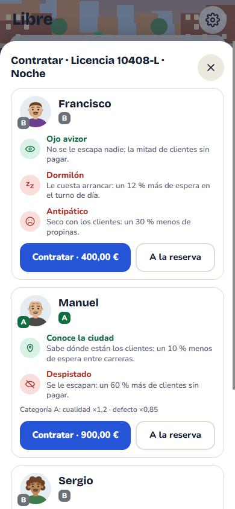
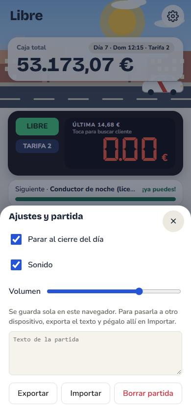

# Libre: documento de diseño

Iván · creado el 13 de noviembre de 2026 · actualizado el 17 de noviembre de 2026 (rework visual)

Este documento describe el juego tal como está hoy: qué es, cómo se juega, cada sistema con sus números y por qué está así. Las cifras exactas viven en `js/config.js`; si algo cambia allí, este documento debe seguirle.

---

## 1. Concepto

Juego incremental de gestión para navegador: empiezas como taxista autónomo en Madrid con un solo coche y creces hasta dirigir una flota. A largo plazo, la idea es llegar a un imperio de transporte mundial. Se llama **Libre**, por la luz verde del taxi.

- **Plataforma:** web, jugable en PC y móvil (pensado primero para móvil).
- **Género:** gestión idle, no clicker puro. El interés está en equilibrar piezas que dependen entre sí: licencias, coches, conductores, demanda y costes.
- **Tono:** realista y de barrio. Tarifas, licencias, libranzas, turnos y zonas basados en el taxi real de Madrid; los eventos y objetos tienen humor de taxista (la Planta de Paconi, el Bidón energético).
- **Objetivo del proyecto:** proyecto personal para divertirse y aprender a trabajar con Claude Code.

### Pilares

1. **El taxi de verdad.** Si un dato existe en el mundo real (tarifas, número de licencias, libranzas), el juego lo usa tal cual. Lo inventado se marca como valor de equilibrio.
2. **Decisiones, no clics.** Tus carreras son a clic, pero el juego se gana organizando: qué licencia comprar, a quién contratar, en qué turno ponerlo y qué llevar en el coche.
3. **Cada conductor es alguien.** Retrato, nombre, categoría, cualidades, defectos, nivel y objetos: la flota se recuerda por sus personas.
4. **Cuentas claras.** Cada jornada termina con un ticket de taxímetro que dice qué ha pasado y cuánto se ha ganado.

---

## 2. Bucle de juego

**Bucle corto (segundos).** Tocas el taxímetro, esperas cliente, el taxímetro sube en directo y cobras. Tus conductores hacen lo mismo solos y cada cobro salta en pantalla con su nombre («+14,20 € Marta»).

**Bucle medio (una jornada, unos 100 segundos).** El día avanza de 7:00 a 7:00 con tarifas y demanda que cambian por horas. Al cierre sale el ticket con recaudación, gastos, neto e incidencias; el juego se para hasta que arrancas el día siguiente. Entre jornadas reorganizas a tus conductores.

**Bucle largo (horas).** Compras licencias y coches, contratas conductores, abres zonas y mejoras, encuentras objetos y subes de nivel a tu gente. Cuando tienes la Oficina de gestión puedes dejar el volante y dirigir solo la flota.

**Ritmo medido** (bot que compra flota en cuanto puede y mejoras que se pagan pronto): la segunda licencia llega hacia el minuto 24–44 y **tres licencias con sus seis turnos cubiertos, hacia el minuto 69–78**. Las libranzas alargaron este ritmo desde unos 52–63 minutos; Iván decidió dejarlo así (17-11-2026).

---

## 3. Datos reales de Madrid

El juego calcula cada carrera con la fórmula real del taxímetro: inicio de servicio + kilómetros × precio por km + tiempo parado × precio por hora. Tarifas de 2026, en vigor desde el 1 de enero ([Europa Press](https://www.ultimahora.es/noticias/comunidades/2025/12/07/2526987/tarifas-taxi-ciudad-madrid-suben-partir-del-enero-2026.html), [Time Out Madrid](https://www.timeout.es/madrid/es/noticias/estos-seran-los-nuevos-precios-para-viajar-en-taxi-por-madrid-a-partir-de-2026-una-subida-de-mas-del-2-120925)).

| Tarifa | Cuándo se aplica | Inicio | Precio por km | Precio por hora |
| --- | --- | --- | --- | --- |
| Tarifa 1 | Laborables de lunes a viernes, 7:00 a 21:00 | 2,55 € | 1,40 € | 27,00 € |
| Tarifa 2 | Todos los días de 21:00 a 7:00; sábados, domingos y festivos de 7:00 a 21:00 | 3,20 € | 1,60 € | 29,00 € |
| Tarifa 3 | Salidas de Barajas a destinos fuera de la M-30 | 22 € de bajada de bandera que cubren los primeros 9 km; después, tarifa 1 o 2 | | |
| Tarifa 4 | Fija entre Barajas y el interior de la M-30 | 33 € | | |

Otros datos reales que usa el juego (confirmados por Iván el 13 y el 16 de noviembre de 2026):

- **Licencias en el área de Madrid:** 15.812 (el máximo que puede tener el jugador).
- **Espera en la parada de Barajas:** entre 1 y 2 horas.
- **Combustible:** 1,55 €/litro; el coche gasta 6 litros a los 100 km.
- **Cuota de autónomo:** 535 € al mes (17,83 € por jornada).
- **Seguro:** 10 € por coche y día. **Emisora:** 3 € por coche y día.
- **Conductor asalariado:** se queda el 50 % de lo que recauda.
- **Libranza:** cada licencia libra según su letra, que sale de la última cifra del número: lunes (L) si acaba en 7 u 8, martes (M) en 9 o 0, miércoles (X) en 1 o 2, jueves (J) en 3 o 4 y viernes (V) en 5 o 6. En fin de semana libra según la paridad del día del mes: una licencia par trabaja los días pares y libra los impares; una impar, al revés. La letra del miércoles está por confirmar (el juego usa X).

**Valores de juego, no reales:** licencia 3.000 € (sube un 15 % con cada compra) y coche 1.500 €, fijados por Iván. Todo lo demás que no aparece arriba (demanda, precios de mejoras, probabilidades) es equilibrio y se ajusta jugando.

Datos reales que el juego aún no usa: tarifa 7 (recorridos de menos de 1.450 m, 8 €) y suplemento de Nochebuena y Nochevieja (7 €).

---

## 4. Pantallas

El juego es una sola columna, pensada para un móvil en vertical (390 × 844 de referencia). Arriba va siempre la **cabecera con la calle**; abajo, un menú fijo de cuatro pestañas: **Calle**, **Conductores**, **Almacén** y **Mejoras**. Los ajustes y la partida no son una pestaña: los abre el **engranaje** de la cabecera. Una marca roja en una pestaña avisa de que hay algo que comprar (Conductores, Mejoras), consumibles por reponer u objetos esperando en la bandeja (Almacén), o un ticket por leer (Calle).

### Cabecera

Una escena dibujada de la calle: cielo que sigue la hora del juego (amanecer, día, atardecer y noche), sol o luna y estrellas, edificios con ventanas que se encienden y parpadean de noche, nubes, un taxi que pasa y lluvia cuando llueve. Es adorno: no enseña datos.

Encima va la placa **«Caja total»**, siempre a la vista: el dinero y, en Calle, el chip «Día 7 · Dom 10:32 · Tarifa 2». En Calle la cabecera es alta (220 px; 180 en pantallas de menos de 830 px de alto, para que todo quepa sin desplazar); en las demás pestañas es compacta (124 px) y solo se ve la calle. Al desplazar la página sube hasta dejar solo la placa. De noche, la placa y el engranaje pasan a fondo oscuro con letra clara.

### Calle

<p>


</p>

De arriba abajo, debajo de la cabecera:

- **Taxímetro** de 132 px: cuerpo oscuro, piloto y tarifa a la izquierda y una pantalla de LED rojo (letra DSEG7, con punto decimal: «13.16 €»). Encima de las cifras, qué marca y una segunda línea con lo que pasa. Tres modos que cambian solos:
  - **Conductor** (izquierda), cuando conduces y es tu turno: piloto LIBRE en verde u OCUPADO, importe en vivo, «Con pasajero · 4,5 km» y una raya con el avance de la carrera. Todo el taxímetro es el botón de buscar cliente.
  - **Flota** (derecha), el resto del tiempo: piloto FLOTA en amarillo, el display suma lo recaudado hoy por toda la flota, la segunda línea resume «2 ocupados · 3 parados» y debajo del piloto sale la hora de tu turno. Tocarlo abre el desglose de la caja de hoy.
  - **Libranza**, el día que libra tu licencia si ningún taxi de la flota puede trabajar y no tienes otra licencia a la que pasarte: «HOY LIBRAS · Toca para saltar al cierre ›». Tocarlo salta al ticket de ese día (ver 5.4).
- **Siguiente:** tarjeta con la compra más barata que aún no te puedes permitir, lo que falta y su barra; cuando llega el dinero dice «¡ya puedes!» y lleva a ella.
- **Tus taxis hoy:** una fila de 44 px por taxi con retrato (el de cada conductor lleva su rareza abajo a la izquierda y su nivel abajo a la derecha, como en Conductores), nombre, licencia y zona («15288-L · Centro»; si no cabe, se corta la zona, nunca la licencia), chip de estado (Libre en verde, Ocupado en azul, Libranza en gris, De baja en rojo; Avería, Pinchazo o Limpieza en ámbar), lo facturado en la jornada y una barra proporcional al que más lleva. Las filas se reordenan con una animación cuando un taxi adelanta a otro y destellan al cobrar. Con más de 6 taxis, «Ver los N restantes». Tocar una fila lleva a ese taxi en Conductores; tocar el total abre el desglose de la caja.
- **Zonas:** chips con el nombre y «25 viajes/h» (o «Abre a las 21:00»); en azul las que tienen clientes ahora y rellena la tuya cuando conduces (tocar otra te lleva allí). Las cerradas, en un último chip gris y discontinuo («2 cerradas · Qué las abre ›»); al tocarlo dice qué mejora abre cada una.

Con 5 taxis, Calle cabe sin desplazar en 390 × 844 y en 375 × 800. El **ticket de cierre** sale aquí, debajo del taxímetro, al acabar la jornada (ver más abajo).

### Conductores

<p>



</p>

- **Reserva:** tarjeta con 5 huecos. Los conductores que esperan turno son caras; los huecos libres («+») abren los candidatos.
- **Licencias, de dos en dos:** la placa con su número y letra (chip «Libra» el día que le toca librar) y dos casillas de turno, cada una con un sol o una luna, la cara y el nombre. La cara lleva la rareza abajo a la izquierda, el nivel abajo a la derecha y un «!» rojo si el conductor está parado (baja, avería, libranza). La última casilla es **«Comprar licencia»**, que abre dos placas para elegir, cada una con su libranza.
- **Ficha del conductor** (centro): una hoja que sube desde abajo (se desplaza por dentro desde que lleva las estadísticas). Nombre, rareza, licencia y turno; nivel con su barra de experiencia; cualidades en verde y defectos en rojo, cada uno con lo que hace; un mosaico de 3 casillas de objetos (puesto, con su efecto en corto y una «×» para quitarlo; «Equipar»; o el nivel que abre el hueco); **estadísticas** (ver abajo); carreras, facturado y zona (solo de lectura: la eligen ellos); y los botones **Cambiar de sitio** y **Despedir · finiquito**. Cambiar de sitio solo se puede entre jornadas: durante el día sale desactivado con una línea que lo explica.
- **Estadísticas de la ficha** (Iván, 17-11-2026): el valor real de cada stat del conductor, ya sumados rasgos, objetos, nivel y mejoras y con los topes, y debajo de dónde sale cada cambio. En verde si le favorece y en rojo si le perjudica:
  - **Espera entre carreras**: en % (no hay un tiempo fijo, depende de la zona y la hora), con los rasgos y objetos de día o de noche marcados; los que no son de su turno salen con «no cuenta».
  - **Propina**, **Se va sin pagar**, **Devuelve un olvido** y **Encuentra un objeto**: % de las carreras.
  - **Baja**, **Pinchazo** y **Avería**: % de los turnos (se sortean al empezar cada uno).
  - **Limpiar un vómito**: lo que cuesta y cuánto tiempo para.
  - Las cualidades y defectos salen con la fuerza de su categoría (una cualidad de un S pesa más que la de un B), y si una stat llega al tope lo dice.
- **Comparar** (Iván, 18-11-2026): «Comparar con otro conductor» en la ficha te deja tocar a otro (también durante la jornada) y abre una hoja con los dos lado a lado: cara, rareza, nivel y dónde trabajan; un resumen («Isabel es mejor en 2 de 9 estadísticas; Elena, en 1»); una fila por estadística con el mejor de los dos en verde y «▲»; y rasgos, objetos, carreras y facturado. Cada uno cuenta en su turno (lo que es solo de día o de noche, en el suyo). Con el día cerrado, «Intercambiarlos» los cambia de sitio. Cada candidato tiene además «Comparar con…» para elegir a uno de tus conductores.
- **Equipar** abre encima otra hoja con los objetos del almacén en casillas, de mejor a peor; los que ya lleva salen atenuados. Tocar uno lo equipa.
- **Candidatos** (derecha): hoja con tres tarjetas, cada una con retrato, rareza, rasgos, «Contratar · precio» y «A la reserva»; si no llega el dinero, cuánto falta y, al pie, vender objetos para contratar. Si tu turno de esa licencia está libre, también «Conducir yo este turno».
- **Entre jornadas** (con el día cerrado), los conductores se cambian de sitio: con ratón, arrastrándolos; en el móvil, **manteniendo pulsado** su retrato medio segundo (lo «coge», vibra un poco) y **tocando dónde ponerlo** (otro conductor para intercambiarlos, un turno libre o un hueco de la reserva). Si sigues con el dedo, también se arrastra. «Cambiar de sitio» en la ficha hace lo mismo. Mientras está cogido, una barra dice «Toca dónde poner a Elena · Cancelar» (Iván, 18-11-2026: en el móvil el arrastre no funcionaba).

### Almacén

<p>

</p>

- **Consumibles:** ruedas de repuesto y bolsas de papel en filas, con su dibujo, una barra sobre el máximo («6 / 10», en rojo si quedan pocas) y chips de compra de una unidad y de diez.
- **Objetos sin equipar:** casillas de 3 columnas, de mejor a peor, **sin nombre a la vista** (decisión de Iván): rareza, cantidad y el dibujo sobre el color de su categoría. Al tocar una se abre debajo su panel con el nombre, qué hace, cuántos hay equipados y «Vender».
- **Bandeja:** si un conductor encuentra algo con el almacén lleno, arriba aparece en amarillo «Almacén lleno · N por guardar», con lo que espera y la lista para vender.

### Mejoras

<p>

</p>

Un chip por rama (la elegida, en azul) y debajo los nodos de esa rama en una lista vertical. Cada nodo tiene un círculo de estado: **comprado** (verde con ✓), **disponible** (azul; el precio en gris si aún no llega el dinero) o **bloqueado** (gris con candado). Las mejoras por niveles llevan una rayita por nivel. Al tocar un nodo se abre debajo qué hace, el nivel que toca y el botón «Comprar nivel 3 · 1.000,00 €».

### Ticket de cierre y ajustes

<p>


</p>

- **Ticket de cierre** (izquierda): aparece en Calle al acabar la jornada, en papel térmico con letra de máquina (Courier Prime). Cabecera con las licencias que trabajaron; carreras, kilómetros, recaudación, combustible, conductores, costes fijos y neto (en ese orden); debajo, las incidencias. El juego se para hasta «Arrancar día siguiente».
- **Ajustes y partida** (derecha), desde el engranaje: parar al cierre del día, sonido sí o no y volumen, y exportar, importar o borrar la partida.

### Sistema visual

Estilo ilustrado y cálido, tema claro. La referencia completa (maquetas, iconos y fuentes) está en `libre-rework/`, fuera del repositorio.

- **Colores** («Cielo de Madrid»): fondo de papel `#F6F3EC`, tarjetas blancas con borde `#E3DDCF`, tinta azul oscura `#172033`. **Azul** `#2554D6` para la marca, los botones y lo ocupado; **verde** `#0F6E42` para el dinero y lo libre; **amarillo sol** `#FFC83D` para destacar; **rojo** `#B3302A` para gastos, bajas y peligro. Los estados van sobre tintes claros (verde, azul, ámbar, rojo y neutro). Todos los colores son variables en un solo sitio (`:root` de `css/estilos.css`).
- **Rarezas:** B gris, A verde, S azul, S+ morado y LEGENDARIO amarillo, siempre en una insignia redondeada con la letra.
- **Letras:** Bricolage Grotesque para títulos y cifras de dinero; Nunito para el texto; Courier Prime para el ticket; DSEG7 para el LED del taxímetro.
- **Componentes:** tarjetas de esquinas redondeadas, chips de estado, botones de 48 px (principal azul, secundario blanco, peligro rojo claro), barras de 8 px e insignias de rareza. Todo lo que se toca mide al menos 44 px.
- **Logo:** un taxi de Madrid de frente, con la luz verde de «libre» y el sol, sobre el azul de marca (`docs/logo/libre-icono.svg`, también icono de la pestaña); con el nombre en Bricolage Grotesque en `docs/logo/libre-logo.svg`.
- **Iconos:** cada objeto y consumible tiene su dibujo (26 en total, con trazo oscuro y relleno plano). Los rasgos y los turnos usan iconos de trazo.
- **Animaciones:** el taxi que cruza la calle (16 s), dos nubes (40 y 55 s), el sol que late (5 s), las ventanas de noche (4 y 6 s), la lluvia, el ticket que se imprime, las filas que se reordenan, los importes que flotan al cobrar y las hojas que suben. Todas se apagan con «reducir movimiento».
- **Sonidos**, sintetizados en el navegador (sin archivos) y mudos hasta el primer toque: **cobro** (un «ding» de caja registradora al cobrar cualquier taxi), **propina** (monedas), **nivel** (arpegio), **objeto** (brillo), **avería** (golpe sordo; también pinchazos), **ticket** (impresora) y **tic** (al bajar la bandera). Se ajustan a oído.

---

## 5. Sistemas

### 5.1 Reloj y jornada

- **Un día de juego dura 100 segundos reales.** La mejora Jornada larga lo alarga hasta 60 s más; los coches trabajan al mismo ritmo real, así que caben más carreras contra el mismo coste fijo diario.
- **Turnos:** día de 7:00 a 19:00 y noche de 19:00 a 7:00.
- **Jornada de 7:00 a 7:00.** A las 7:00 se cierra la caja, se cobran los costes fijos y sale el ticket. La madrugada cuenta como la noche del día anterior.
- **Fin de semana:** sábado y domingo, tarifa 2 todo el día.
- **Sin conexión:** el juego cuenta hasta 8 horas reales fuera, con la media de cada zona y hora (sin eventos nuevos). Si había pausa al cierre, resuelve los días seguidos y deja un único ticket con la suma. Da entre un 2 % y un 4 % más que jugando (medido el 17-11-2026 con varias flotas; con conductores de mucha o poca espera, algo más). Tu turno no produce mientras estás fuera.

### 5.2 Zonas

Cada zona tiene una demanda de viajes por hora que cambia con la hora, el día de la semana y un pequeño azar por jornada (±20 %). Si hay más coches de los que la zona pide, los que sobran esperan más y gastan combustible en vacío (o esperan en la cola sin gastar, en las zonas con parada).

| Zona | Cómo se abre | Carácter | Viajes |
| --- | --- | --- | --- |
| Centro | Desde el principio | Muchas carreras cortas, demanda constante; se vacía de madrugada | 1,8 km (45 %), 3,5 km (40 %), 7 km (15 %) |
| Ocio nocturno | Desde el principio | Solo de noche y sobre todo de jueves a sábado; siempre tarifa 2; rinde claramente más que el centro de noche | 4 km (30 %), 8 km (45 %), 13,5 km (25 %) |
| Estaciones | Mejora Parada en Atocha y Chamartín | Picos con la llegada de los trenes; cola corta de unos 6 min | 3 km (35 %), 6 km (45 %), 11 km (20 %) |
| Aeropuerto | Mejora Acreditación de Barajas | Carreras caras con tarifa fija; cola de 1 a 2 horas en la parada | 60 % tarifa 4 (33 €), 40 % tarifa 3 a 7, 18 o 32 km |

**Lluvia:** el 20 % de las jornadas llueve de 1 a 3 horas y la demanda se duplica en todas las zonas.

### 5.3 Carreras

- **Tus carreras (a clic):** tocas el taxímetro, esperas según la demanda de tu zona (con poca demanda, hasta que aparece alguien), viajas y cobras. Solo puedes trabajar dentro de la franja de tu turno y no el día que libra tu licencia.
- **Las de tus conductores (solas):** cada conductor espera su parte de la demanda de la zona, viaja y cobra al terminar; el 50 % es suyo. Sin clientes, hace un tramo en vacío hasta la hora siguiente.
- **Zonas de los conductores:** las eligen ellos. Sin el Curso gestión de zonas, al azar entre las que tienen clientes; con el curso, cada hora la que más deja al dueño contando a los compañeros. La tuya la eliges tú.

### 5.4 Licencias, coches y libranza

- **Licencia:** 3.000 € la segunda y un 15 % más cara cada siguiente, hasta las 15.812 de Madrid. Al comprarla eliges entre **dos placas con letras distintas**, cada una con su libranza.
- **Coche:** 1.500 € (un solo modelo, Turismo). Sin coche, la licencia no trabaja.
- **Libranza:** el día que le toca, la licencia no trabaja en ninguno de sus dos turnos, tampoco el tuyo. Cada licencia libra unos 2 de cada 7 días (su día de semana y la mitad de los fines de semana). Los costes fijos se pagan igual: elegir bien la placa reparte las libranzas de la flota.
- **Saltar el día de libranza:** si libra tu licencia y ese día no puede trabajar nadie (no hay conductores, o sus licencias también libran o están de baja o averiadas) y no tienes otra licencia a la que pasarte, el taxímetro ofrece **saltar al cierre**: el reloj corre de golpe hasta las 7:00, se pagan los costes fijos y sale el ticket del día. Cuenta como licencia a la que pasarte una con coche, que no libre ese día y con un turno libre, si tienes la Oficina de gestión (sin ella no puedes dejar tu turno). Si hay flota trabajando, el día corre normal.

### 5.5 Costes

| Coste | Cuánto | Cuándo |
| --- | --- | --- |
| Combustible | 1,55 €/l × 6 l/100 km, también en vacío | En cada carrera |
| Conductor | 50 % de lo que recauda | En cada carrera |
| Cuota de autónomo | 17,83 € | Al cierre de cada jornada |
| Seguro | 10 € por coche (baja con mejoras) | Al cierre |
| Emisora | 3 € por coche, solo con la mejora Emisora | Al cierre |
| Incidencias | Limpiezas, neumáticos, reparaciones, finiquitos | Cuando pasan |

### 5.6 Conductores

**Contratar.** Hay siempre tres candidatos (personajes y cualidades distintos), con su retrato, categoría, rasgos y precio. Cambian cada día, al cerrar la caja (Iván, 17-11-2026), y también al contratar a uno: entonces salen otros tres. Si no te llega, la tarjeta dice cuánto falta y deja vender objetos ahí mismo. Se puede contratar para un turno libre o para la reserva.

**Categorías.** Salen al azar, con los mismos pesos que los objetos:

| Categoría | Probabilidad | Precio | Cualidades | Defectos | Fuerza de la cualidad | Fuerza del defecto | Encuentra objetos | Espera de serie | Abre los topes |
| --- | --- | --- | --- | --- | --- | --- | --- | --- | --- |
| B | 65 % | 400 € | 1 | 2 | ×1 | ×1 | ×1 | — | 0 |
| A | 25 % | 850 € | 1 | 1 | ×1,2 | ×0,85 | ×1,15 | −5 % | 0,1 |
| S | 7,5 % | 1.200 € | 1 | 1 la mitad de las veces | ×1,4 | ×0,7 | ×1,3 | −12 % | 0,2 |
| S+ | 2 % | 1.800 € | 1 | 0 | ×1,6 | — | ×1,5 | −25 % | 0,3 |
| LEGENDARIO | 0,5 % | 3.350 € | 2 | 0 | ×1,8 | — | ×2 | −55 % | 0,75 |

**Que la categoría se note más que el nivel** (Iván, 17-11-2026): cada categoría espera menos de serie, le toquen los rasgos que le toquen, y abre más sus topes. Medido con un bot al final de la partida (nivel 10 y los mismos tres objetos buenos para todos), un conductor deja por jornada: B 151 €, A 164 €, S 174 €, S+ 185 € y LEGENDARIO 223 € (**+47 % sobre un B**).

**Precios** (Iván, 17-11-2026): el del B más lo que un conductor de esa categoría deja de más que un B en **40 jornadas** (unos 67 minutos de juego), medido con un bot al principio de la partida: A +11 €, S +20 €, S+ +35 € y LEGENDARIO +74 € por jornada. Antes un LEGENDARIO costaba 12.000 € y tardaba unas 450 jornadas en compensar frente a un B.

Con tres candidatos, una de cada 65 tandas más o menos ofrece un LEGENDARIO (y ahora sale una tanda nueva cada día, además de una tras cada contrato); al principio cuesta ahorrar para él, y esa es la gracia.

**Rasgos.** Una cualidad nunca sale con su defecto opuesto. La fuerza de la categoría escala el efecto («+45 %» con fuerza ×1,8 es «+81 %»).

Equilibrio (Iván, 17-11-2026): cada cualidad vale cerca de **+5 %** de lo que deja un conductor B y cada defecto cerca de **−5 %**, medido con un bot (480 partidas de 120 jornadas por rasgo, sin mejoras ni bolsas; los de solo día o solo noche, sobre los conductores de ese turno). La curva sale de ahí: al nivel 10 se pierde un defecto, y con mejoras algunos efectos se anulan (bolsas: la limpieza; la mejora contra impagos: los sin pagar). Por eso los rasgos que dependen de esos sucesos llevan un segundo efecto.

| Cualidad | Efecto | Defecto opuesto | Efecto |
| --- | --- | --- | --- |
| Simpático | el doble de propinas | Antipático | −75 % de propinas y +8 % de espera |
| Cuidadoso | −75 % de pinchazos y averías, −38 % de limpieza | Manazas | +75 % de pinchazos y averías, +50 % de limpieza |
| Conoce la ciudad | −12 % de espera | Lento | +14 % de espera |
| De hierro | −80 % de bajas y −9 % de espera | Enfermizo | el doble de bajas y +8,5 % de espera |
| Ojo avizor | −80 % de clientes sin pagar y −10 % de espera | Despistado | el doble de clientes sin pagar y +11 % de espera |
| Honrado | el doble de objetos devueltos y +35 % de propinas | Aprovechado | −70 % de objetos devueltos y −60 % de propinas |
| Búho | −12 % de espera de noche | Trasnochador flojo | +18 % de espera de noche |
| Madrugador | −12 % de espera de día | Dormilón | +16 % de espera de día |
| Pulcro | la mitad de limpieza y +45 % de propinas | Guarro | +70 % de limpieza y −45 % de propinas |

«Limpieza» es el coste y el tiempo parado al limpiar un vómito (solo cuenta si no quedan bolsas).

**Experiencia y niveles.** Cada carrera da 1 punto (un conductor hace unas 25–30 por jornada). Cada nivel acorta la espera un 1,5 % (antes un 2,5 %: pesaba más que la categoría); los niveles 4 y 8 abren un hueco más de objeto. **Al llegar al nivel 10** pierde un defecto o, si no tiene ninguno, gana una cualidad nueva.

| Nivel | 1 | 2 | 3 | 4 | 5 | 6 | 7 | 8 | 9 | 10 |
| --- | --- | --- | --- | --- | --- | --- | --- | --- | --- | --- |
| Experiencia total | 0 | 20 | 48 | 87 | 142 | 219 | 326 | 477 | 688 | 983 |
| Huecos de objeto | 1 | 1 | 1 | 2 | 2 | 2 | 2 | 3 | 3 | 3 |

El nivel 5 llega hacia la quinta jornada y el 10 hacia la 35 (cerca de una hora de juego por conductor).

**Topes que crecen** (Iván, 17-11-2026). Rasgos, nivel, objetos y mejoras se multiplican, pero el resultado no pasa de unos límites sobre el valor normal. Lo malo tiene siempre el mismo freno; lo bueno se abre con la categoría y el nivel: cada conductor tiene una apertura de 0 a 1 (la de su categoría, en la tabla de arriba, más 0,25 por subir del nivel 1 al 10). Con apertura 0 (un B de nivel 1) valen los topes de la primera columna; con 1 (un LEGENDARIO de nivel 10), el extremo; entre medias, a medio camino.

| Valor | Lo malo, como mucho | Lo bueno con apertura 0 | Lo bueno con apertura 1 |
| --- | --- | --- | --- |
| Espera entre carreras (sin contar las mejoras de búsqueda) | ×1,4 | ×0,6 | ×0,2 |
| Propinas (con la mejora Propinas) | ×0,5 | ×2,5 | ×7 |
| Objetos devueltos | ×0,3 | ×2 | ×4 |
| Sin pagar, bajas, pinchazos, averías | ×2 | ×0,3 | ×0,05 |
| Limpieza de un vómito | ×1,5 | ×0,4 | ×0,15 |

Por ejemplo, la espera de un B de nivel 10 puede bajar hasta ×0,46 y la de un S+ de nivel 10 hasta ×0,33. La ficha enseña el tope de cada stat («su tope ×0,46»).

La Cámara de seguridad sigue dejando a cero los clientes sin pagar.

**Reserva.** Hasta 5 conductores contratados sin turno. No trabajan, no ganan experiencia y no cuestan nada; conservan objetos y nivel.

**Reorganizar.** Solo entre jornadas, con el día cerrado: un conductor se arrastra, o se coge y se toca el destino (también desde su ficha), a otro turno, otra licencia o la reserva; si el sitio está ocupado, se intercambian. Baja, objetos y nivel van con él; la avería se queda en el coche.

**Despedir.** Cuesta un finiquito de 100 € + 60 € por nivel (160 € en el nivel 1, 700 € en el 10), pide confirmación y sale en el ticket. Sus objetos vuelven al almacén.

**Tú.** Tu turno es siempre a clic y no tiene rasgos ni nivel. Con la Oficina de gestión puedes dejar el volante y volver a un turno libre cuando quieras.

### 5.7 Objetos y almacén

- **Encontrarlos:** cada carrera de un conductor tiene un 1,2 % de dar un objeto (más según su categoría). Tú no encuentras, y sin conexión tampoco. Se sortea la categoría con los pesos de la tabla de arriba y, dentro de ella, el objeto. Sale un aviso con su retrato.
- **Almacén:** guarda 10 objetos sin equipar (hasta 40 con Taquillas). Si está lleno, lo encontrado espera en una **bandeja** hasta que vendes algo: nada se vende solo.
- **Equipar:** desde la ficha de cada conductor, en sus huecos, sin repetir objeto. Quitarlo lo devuelve al almacén.
- **Vender:** B 40 €, A 120 €, S 400 €, S+ 1.200 €, LEGENDARIO 4.000 €. Entra en la caja como «Venta de objetos».

| Categoría | Objeto | Efecto |
| --- | --- | --- |
| B | Ambientador | +10 % de propinas |
| B | Cojín lumbar | −15 % de bajas |
| B | Termo de café | −4 % de espera de noche |
| B | Gafas de sol | −4 % de espera de día |
| B | Funda de asientos | Vómito sin bolsa: −25 % de limpieza y menos rato parado |
| B | Callejero de papel | −3 % de espera |
| A | GPS | −6 % de espera |
| A | Manómetro de ruedas | −30 % de pinchazos |
| A | Caramelos para clientes | +20 % de propinas |
| A | Espejo panorámico | −30 % de clientes sin pagar |
| A | Vitaminas | −30 % de bajas |
| A | Alfombrillas de goma | Vómito: −45 % de limpieza y menos rato parado |
| S | Radio-escáner | −10 % de espera |
| S | Kit de herramientas | −35 % de averías y −20 % de pinchazos |
| S | Cargador para clientes | +30 % de propinas y +20 % de objetos devueltos |
| S | Botiquín | −45 % de bajas |
| S | Datáfono portátil | La mitad de clientes sin pagar |
| S+ | Navegador con tráfico en directo | −14 % de espera |
| S+ | Silla ergonómica | La mitad de bajas y −7 % de espera de noche |
| S+ | Nevera con agua fría | +45 % de propinas y −30 % de limpieza |
| S+ | Detector de baches | La mitad de pinchazos y −30 % de averías |
| LEGENDARIO | Planta de Paconi | −10 % de espera, +30 % de propinas y −30 % de bajas |
| LEGENDARIO | Bocata de calamares infinito | −60 % de bajas y −12 % de espera de día |
| LEGENDARIO | Bidón energético | −22 % de espera de noche y −20 % de bajas |

**Consumibles** (comunes a toda la flota, se compran): **ruedas de repuesto** (80 €, hasta 10; un pinchazo gasta una y el taxi sigue) y **bolsas de papel** (2 €, hasta 50; un vómito gasta una y no pasa nada). Cada uno se desbloquea con su mejora; con pocas unidades, la pestaña Almacén avisa.

### 5.8 Eventos

Van a la caja y salen como incidencias en el ticket. Sin mejoras, su efecto neto queda cerca de cero, salvo los vómitos, que a propósito son un coste que se evita con bolsas.

| Evento | Cuándo | Probabilidad | Efecto |
| --- | --- | --- | --- |
| Propina | Por carrera (también las tuyas) | 15 % | 5 a 25 % del importe |
| Sin pagar | Por carrera | 1 % | Se pierde el importe |
| Objeto devuelto | Por carrera | 1 % | Recompensa de 5 € (paraguas) a 300 € (maletín) |
| Vómito | Por carrera | 0,08 % de día, 1 % de noche, 3 % en Ocio nocturno | Limpieza de 50 a 90 € y una hora parado (con bolsa, nada) |
| Pinchazo | Al empezar un turno | 1,5 % | Neumático de 120 € y parado el resto del turno (con rueda de repuesto, nada) |
| Baja | Al empezar un turno de conductor | 0,8 % | De 1 a 5 jornadas sin trabajar |
| Avería | Al empezar un turno de conductor, con 2 coches o más | 0,08 % | De 10 a 20 jornadas en el taller y 150 a 400 € |
| Lluvia | Una vez por jornada | 20 % | De 1 a 3 horas con el doble de demanda |
| Objeto encontrado | Por carrera de conductor | 1,2 % | Un objeto para el almacén (ver 5.7) |

### 5.9 Mejoras

Cinco ramas. Las que no piden otra abren su rama; las demás piden la anterior (basta su nivel 1). Precios ajustados para que cada mejora se pague en una o dos horas de juego con 6 coches.

**Clientes**

| Mejora | Precio | Efecto |
| --- | --- | --- |
| Bolsas de papel | 800 € | Desbloquea las bolsas en el almacén |
| Callejero al día | 400 € | −10 % de tiempo buscando cliente |
| Taxi impecable | 600 € | +5 % de demanda en todas las zonas |
| Propinas (5 niveles) | 1.350 / 1.980 / 2.700 / 3.600 / 4.500 € | De +3 a +15 puntos de probabilidad y propinas de un 15 a un 80 % mayores |
| Pago con tarjeta | 1.440 € | +10 % de demanda |
| Cámara de seguridad | 1.000 € | Nadie se va sin pagar |
| Clientes de siempre | 2.000 € | +8 % de demanda |

**Ciudad y radio**

| Mejora | Precio | Efecto |
| --- | --- | --- |
| Parada en Atocha y Chamartín | 2.500 € | Abre Estaciones |
| Acreditación de Barajas | 2.000 € | Abre el Aeropuerto |
| Emisora de radio-taxi | 1.300 € | −30 % de tiempo buscando; cuota de 3 € por coche y día |
| Parada junto a las salas de fiesta | 2.300 € | En Ocio: la mitad de tiempo buscando y +15 % de demanda |
| Turnos coordinados en Barajas | 3.000 € | La cola del aeropuerto, a la mitad (30–60 min) |
| App de pedidos | 4.000 € | Otro −30 % de tiempo buscando |

**Vehículo**

| Mejora | Precio | Efecto |
| --- | --- | --- |
| Deflectores de viento | 350 € | −15 % de bajas: los conductores ventilan sin corrientes |
| Curso de conducción eficiente | 800 € | −10 % de combustible |
| Neumáticos de bajo consumo | 900 € | −8 % de combustible |
| Flota híbrida | 4.000 € | −35 % de combustible |

**Taller y seguros**

| Mejora | Precio | Efecto |
| --- | --- | --- |
| Rueda de repuesto | 300 € | Desbloquea las ruedas en el almacén |
| Mecánico propio (5 niveles) | 300 / 525 / 750 / 1.050 / 1.350 € | Averías de un 15 a un 65 % más cortas y de un 15 a un 60 % más baratas |
| Póliza de flota | 700 € | −20 % de seguro |
| Curso de seguridad vial | 675 € | Otro −25 % de seguro |

**Conductores y jornada**

| Mejora | Precio | Efecto |
| --- | --- | --- |
| Curso gestión de zonas | 2.500 € | Los conductores van cada hora a la zona que más deja |
| Taquillas (3 niveles) | 600 / 1.800 / 4.500 € | Almacén de 20, 30 y 40 objetos |
| Sacudir esterillas (5 niveles) | 450 / 720 / 990 / 1.350 / 1.800 € | Cada conductor encuentra de 0,50–2 € a 3–8 € al acabar su turno |
| Jornada larga (5 niveles) | 400 / 700 / 1.000 / 1.400 / 1.900 € | El día dura 10, 20, 30, 45 y 60 s más |
| Oficina de gestión | 6.000 € | Puedes dejar el volante y solo gestionar (pide el nivel 1 de Jornada larga) |

---

## 6. Progresión a largo plazo

El juego completo tiene cinco etapas; cada una añade un tipo de vehículo y una mecánica nueva, sin quitar las anteriores. **Hoy solo existen las etapas 1 y 2.**

| Etapa | Qué gestionas | Mecánica nueva |
| --- | --- | --- |
| 1. Autónomo | Un taxi que conduces tú | Elegir zona y horario; primer conductor para el segundo turno |
| 2. Flota de Madrid | Varias licencias y conductores | Zonas, aeropuerto y estaciones, conductores con categorías, objetos |
| 3. Empresa de movilidad | VTC, furgonetas, autobuses | Gerentes que automatizan, contratos con hoteles y empresas |
| 4. Operador nacional | Autocares, trenes, logística | Varias ciudades y rutas entre ellas |
| 5. Imperio mundial | Aerolíneas y navieras | Rutas entre continentes |

**VTC:** aparecerán en la etapa 3 como rival que resta demanda en algunas zonas, antes de que el jugador pueda tener las suyas.

**Prestigio:** a partir de la etapa 3, vender la empresa y empezar en otra ciudad con una ventaja permanente (por ejemplo, reputación que aumenta la demanda).

### Alcance de la versión actual

Incluye todo lo descrito en las secciones 4 y 5. Queda fuera: VTC y otros vehículos, gerentes, otras ciudades, prestigio, la tarifa 7 y los suplementos de Nochebuena y Nochevieja.

---

## 7. Técnica

HTML, CSS y JavaScript sin framework ni paso de compilación; se juega abriendo `index.html` y se publica tal cual en GitHub Pages.

- **Datos separados del código:** todos los números están en `js/config.js`, marcados como dato real, dato de Iván o equilibrio.
- **Lógica separada de la pantalla:** una sola función avanza el tiempo (`avanzar`), la misma con el juego abierto y sin conexión; la simulación no sabe nada del HTML y se prueba sin navegador (`node tests/simulacion.test.js`).
- **Azar con semilla:** todo lo que afecta a la flota sale de un generador guardado en la partida.
- **Guardado:** `localStorage` con número de versión (hoy, la 21) y migraciones para que las partidas antiguas sigan cargando; exportar e importar como texto. El rework visual no cambió el formato: la pestaña elegida (`libre-vista`), la rama de mejoras y los ajustes de sonido (`libre-sonido`) se guardan aparte, como comodidades del navegador.
- **Módulos de la interfaz:** `js/ambiente.js` dibuja la calle de la cabecera (se puede cambiar por otro módulo, un mapa, sin tocar el resto); `js/retratos.js`, las caras de los conductores; `js/sonidos.js`, los sonidos con Web Audio; `js/interfaz.js`, las pantallas.
- **Recursos propios:** las fuentes van en `fuentes/` (licencias en `fuentes/LICENCIAS.md`, por verificar antes de publicar) y los dibujos de los objetos en `iconos/`. No se carga nada de internet.
- **Diseño:** primero para móvil, una sola columna; colores, letras, espaciados y radios como variables CSS, y componentes base reutilizables (prefijo `ui-`). Todas las animaciones se apagan con «reducir movimiento».

Las convenciones de código están en `CLAUDE.md`.

---

## 8. Historial de decisiones

**13 de noviembre de 2026**

- El día dura 100 segundos y se alarga con mejoras; los costes fijos se cobran una vez por jornada.
- Los conductores cobran un porcentaje de lo que recaudan (50 %, dato de Iván).
- El precio de la licencia sube con cada compra.
- Tus carreras son siempre a clic, también con conductores. Dejar de conducir es una mejora (Oficina de gestión).
- La jornada va de 7:00 a 7:00, con pausa y ticket al cierre (desactivable).
- Ocio nocturno rinde más que el centro de noche, sobre todo de jueves a sábado.
- Cada licencia recibe un número al azar con su letra.
- El juego se llama Libre.

**16 de noviembre de 2026**

- Los conductores hacen carreras reales y cobran al terminar cada una.
- Eventos aleatorios: propinas, impagos, objetos devueltos, vómitos (con bolsas), pinchazos (con ruedas de repuesto), bajas, averías y lluvia.
- Tarifa 3 con bajada de bandera de 22 € hasta 9 km; espera de 1 a 2 horas en Barajas.
- Conductores con cualidades y defectos, experiencia hasta el nivel 10, objetos equipables y finiquito al despedir.

**17 de noviembre de 2026**

- Los objetos ya no se compran: los encuentran los conductores. 24 objetos en cinco categorías (B, A, S, S+, LEGENDARIO), con venta y bandeja.
- Los conductores también tienen categoría, que fija su precio y la fuerza de sus rasgos; los B tienen dos defectos y el nivel 10 quita un defecto o da una cualidad.
- Reserva de conductores y reorganización entre jornadas, arrastrando.
- La libranza entra en el juego, con elección entre dos placas al comprar. El ritmo se alarga a unos 70–78 minutos para tres licencias con conductores y se deja así.
- Pantalla Calle con taxímetro de dos modos, lista «Tus taxis hoy» y tira de ambiente; pestaña Flota compacta con licencias de dos en dos; ticket con las licencias que trabajaron.
- Almacén de 10 objetos con la mejora Taquillas; Jornada larga en una sola mejora de cinco niveles que abre la Oficina de gestión; Deflectores de viento en Vehículo.
- **Rework visual** (paquete de diseño en `libre-rework/`):
  - Paleta «Cielo de Madrid» (azul de marca, verde del dinero, amarillo sol), letras Bricolage Grotesque, Nunito, Courier Prime y DSEG7, y componentes base comunes.
  - Cuatro pestañas: Calle, Conductores, Almacén y Mejoras. Flota se parte en dos y Partida pasa a una hoja que abre el engranaje.
  - Cabecera con la calle animada de día y de noche y la placa «Caja total» siempre visible; alta en Calle (180 px en pantallas bajas, para que Calle quepa sin desplazar) y compacta en el resto.
  - Taxímetro con LED DSEG7; ficha del conductor sin desplazar, con «Cambiar de sitio» desactivado durante la jornada; candidatos y selector de objetos en hojas.
  - El almacén enseña los objetos sin nombre, solo dibujo, cantidad y rareza (Iván).
  - Dibujos propios para los 24 objetos y los 2 consumibles.
  - Sonidos sintetizados desde cero (cobro, propina, nivel, objeto, avería, ticket y tic), mudos hasta el primer toque, con sonido y volumen en Ajustes.
  - Sin cambios en la simulación ni en el formato de guardado.

---

## Anexo: primer prompt para Claude Code

Este fue el prompt con el que empezó el proyecto, con este archivo guardado como `DISENO.md`.

```text
Vamos a crear un juego incremental de gestión para navegador. El diseño completo
está en DISENO.md: léelo entero antes de hacer nada.

En esta sesión construimos SOLO lo que pone en la sección "Primera versión
jugable". No añadas nada de lo que esa sección deja fuera.

Requisitos técnicos:
- HTML, CSS y JavaScript sin frameworks ni paso de compilación. Debe funcionar
  abriendo index.html y publicándolo en GitHub Pages.
- Todos los números del juego (tarifas, zonas, vehículos, costes, mejoras) en un
  archivo de configuración separado de la lógica.
- La simulación separada de la interfaz: una función que avanza el estado un
  intervalo de tiempo, sin tocar el HTML. El progreso sin conexión usa esa misma
  función.
- Guardado automático en localStorage con número de versión, más exportar e
  importar partida como texto.
- Interfaz en español, pensada primero para móvil.

Sobre los datos:
- Usa las tarifas reales de DISENO.md tal cual. No inventes cifras reales de
  Madrid: si te falta un dato, pon un valor provisional en la configuración,
  márcalo con un comentario "PROVISIONAL" y dame la lista al final.
- Los valores de equilibrio (demanda por zona, precios de compra, coste de las
  mejoras) sí los propones tú, también en la configuración, para que yo los ajuste
  jugando.

Forma de trabajar:
1. Primero propón un plan: estructura de archivos, modelo de datos del estado
   y orden de construcción. Espera a que lo apruebe antes de escribir código.
2. Construye por pasos pequeños que se puedan probar en el navegador, empezando
   por un solo taxi que genera dinero con el reloj del juego.
3. Crea un CLAUDE.md con las convenciones del proyecto y mantenlo al día.
4. Haz un commit de git al terminar cada paso.
```
